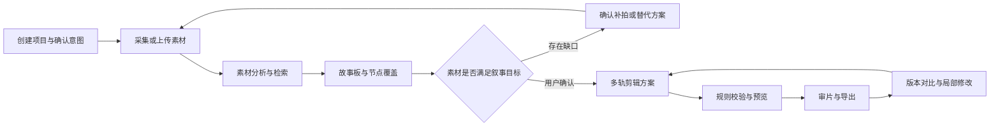

# ShadowWeaveAI · 影织 AI

**光影共创：多智能体驱动的主动感知与智能影像创作平台。**

影织 AI 面向校园生活、旅行、家庭与朋友记录、个人 Vlog、小型组织宣传五类场景，计划通过移动端拍摄指导和 Web 创作工作台，串联素材理解、故事规划、补拍、剪辑、审片与版本管理。

> **项目状态：第一阶段可运行内核，待阶段复核。** 已实现 Web / Flutter Web、FastAPI、基础迁移、共享契约和两组可执行规则样例，并通过本机测试与双端联调。真实素材理解、生产版本提交和七角色工作流仍待后续实施；Android 真机采集与模型调用尚无通过证据。详见 [第一阶段报告](docs/reports/phase-1-report.md)。

## 项目希望解决什么问题

- 拍摄时缺少构图、光线、角度和运镜指导，关键镜头容易遗漏。
- 照片、视频和音频分散，难以按人物、事件与表达目标定位素材。
- 素材充足但缺少故事结构，或故事已经确定却不知道还需要补拍什么。
- 局部修改容易影响字幕和声音，需要明确修改范围并保留已锁定内容。
- 成片问题难以定位，需要能关联片段、依据和作品版本的审片建议。

## 创作流程



用户可以选择补拍、替代片段、调整结构或略过节点。局部修改先展示差异与影响，经确认后保存新版本；已锁定内容需保持约束。

## 创新性判断与执行优先级

本项目不把“七个 Agent”、大模型、向量检索或技术栈本身当作创新。当前最重要、也最适合做对照验证的差异化机制是：

1. **证据驱动的故事覆盖**：故事节点必须关联真实素材区间和证据；缺口明确区分缺少素材、质量不可用、语义待确认和结构冲突，并生成补拍、替代、重构或略过路径。
2. **依赖感知的局部重规划**：用户提出局部修改后，系统只重算影响集合，展示变化范围，保护锁定的片段和相关声音/字幕依赖，确认后生成新版本。
3. **受约束协作**：七类 Agent 通过统一 Schema、预算、审批和恢复执行上述机制；角色数量不是创新证据。

执行顺序应先完成“缺口→补拍→覆盖更新”和“锁定→局部修改→差异确认”两个可观察闭环，再扩展实时摄影、声音、审片和五类场景。详细比较见 [执行方案创新性分析](docs/innovation-analysis.md)，统一对照、指标、分母和发布门槛见 [评测与证据协议](docs/evaluation.md)。

## 七大功能模块

| 模块 | 计划能力 | 状态 |
| --- | --- | --- |
| AI 智能摄影助手 | 实时画面分析、构图与光线检测、运镜建议、拍摄清单 | 待实现 |
| 智能素材管理中心 | 上传、关键帧与切镜、转写、标签、语义检索、质量与重复检测 | 待实现 |
| AI 创意工作台 | 文字与语音意图、主题、时长、风格、情绪及约束确认 | 待实现 |
| 多 Agent 智能导演中心 | 任务拆解、角色协作、依赖、执行监控、冲突与人工确认 | 待实现 |
| 智能故事板与补拍规划 | 大纲、分镜、节点关联、覆盖检查、补拍与时间预算 | 待实现 |
| AI 智能剪辑工作台 | 多轨时间轴、字幕旁白、声音、转场、预览导出与局部修改 | 待实现 |
| AI 审片与作品管理中心 | 叙事、重复、画质、同步与字幕检查，版本对比及恢复 | 待实现 |

## 七类 Agent

| 角色 | 主要职责 |
| --- | --- |
| 导演 | 拆解创作目标，协调角色与任务，处理冲突 |
| 编剧 | 生成故事大纲、叙事结构和旁白草稿 |
| 视觉 | 理解素材内容，评估候选镜头并保留来源证据 |
| 摄影 | 根据故事节点和现场信息生成拍摄与补拍建议 |
| 剪辑 | 生成满足时长、素材范围及锁定条件的时间轴方案 |
| 声音 | 安排旁白、音乐和环境音 |
| 审片 | 输出可定位、带依据的问题及修改建议 |

角色表示职责边界，可以共享模型和工具。模型结果需要经过结构校验与业务规则校验，不能直接触发媒体命令或越过用户确认。

## 计划技术栈

| 层次 | 选型 | 用途 |
| --- | --- | --- |
| 移动端 | Flutter、Camera API | 拍摄指导、补拍任务与素材回传 |
| Web 端 | Vue 3、TypeScript、Element Plus、Pinia | 素材、故事板、时间轴、审片与版本界面 |
| API | Python、FastAPI | 业务接口、校验、权限与状态同步 |
| 数据 | PostgreSQL、pgvector | 关系数据、版本和向量检索 |
| 后台任务 | Celery、Redis | 素材分析、渲染等耗时任务 |
| AI 编排 | LangGraph、可替换模型适配器 | 七角色工作流、检查点与模型调用 |
| 媒体处理 | FFmpeg、OpenCV、PySceneDetect、Librosa | 解析、分析、代理、音频与渲染 |
| 存储与部署 | S3 兼容对象存储、Docker Compose | 媒体对象存储与开发部署 |

第一阶段 Python、Web、Flutter 依赖已提供锁文件，PostgreSQL 已提供可执行 Compose 配置；安装、启动与验证命令见[开发指南](docs/development.md)。完整模型服务、生产部署和真机硬件条件继续按路线图验证。

## 仓库结构

```text
ShadowWeaveAI/
├── apps/
│   ├── web/                  # Vue Web 创作平台（第一阶段子集，见目录说明）
│   └── mobile/               # Flutter 摄影与补拍端（第一阶段子集，见目录说明）
├── services/
│   ├── api/                  # FastAPI 业务服务（第一阶段子集，见目录说明）
│   └── worker/               # 任务六态骨架（可靠异步执行待后续实现）
├── packages/
│   ├── ai/                   # Agent、工作流与模型适配器（第一阶段子集，见目录说明）
│   ├── media/                # 媒体分析、时间轴校验与渲染（第一阶段子集，见目录说明）
│   └── contracts/            # 跨端数据契约与 Schema（第一阶段子集，见目录说明）
├── docs/
│   ├── README.md             # 文档导航、阅读顺序与事实边界
│   ├── innovation-analysis.md # 执行方案对照、创新价值与资源风险
│   ├── evaluation.md         # 对照、消融、指标分母与证据协议
│   ├── requirements.md       # 完整需求基线
│   ├── architecture.md       # 架构、职责与数据约束
│   ├── design/               # 系统详细设计、数据库设计、Agent 设计
│   ├── development.md        # 开发约定与初始化顺序
│   ├── roadmap.md            # 八阶段计划与验收产物
│   ├── phase-1-outline.md    # 第一阶段工作包、创新样例与验收
│   ├── reports/              # 实际验证、证据摘要和未验证项
│   └── api/README.md         # 接口设计边界
├── infra/                    # PostgreSQL 本地开发容器
├── scripts/                  # 契约生成、回放、媒体/环境与统一检查
├── tests/                    # 契约、规则、API、媒体及 PostgreSQL 测试
├── examples/                 # 授权样例与演示数据约定
├── .github/                  # Issue 与 Pull Request 模板
├── .env.example              # 环境变量参考；通过进程环境设置
├── .editorconfig             # 编辑器格式约定
├── .gitattributes            # 文本换行约定
├── .gitignore                # 本地配置、构建与媒体产物排除
└── CONTRIBUTING.md           # 协作与提交约定
```

Python 通过根目录 `pyproject.toml` 将 API、Worker 状态机、契约、AI 规则和媒体包安装为一个可编辑发行包。Web 和 Flutter 分别管理自身依赖与锁文件；当前没有 npm/Dart 跨包工作区。

## 从这里开始

```shell
git clone https://github.com/Cyrene-06/ShadowWeaveAI.git
cd ShadowWeaveAI
```

1. 阅读 [需求分析](docs/requirements.md)，确认场景、需求编号与验收条件。
2. 从 [文档导航](docs/README.md) 阅读 [创新性分析](docs/innovation-analysis.md) 和 [评测协议](docs/evaluation.md)，明确先验证什么，再阅读 [架构说明](docs/architecture.md)。
3. 阅读 [系统详细设计](docs/design/detailed-design.md)、[数据库设计](docs/design/database-design.md) 和 [Agent 设计](docs/design/agent-design.md)，按统一契约拆分实现。
4. 按 [开发指南](docs/development.md) 安装锁定依赖、执行迁移并启动 API/Web/Flutter Web。
5. 参考 [开发路线](docs/roadmap.md)、[第一阶段实施大纲](docs/phase-1-outline.md) 和 [协作指南](CONTRIBUTING.md) 拆分任务。

完整可执行命令见 [开发指南](docs/development.md)：安装 Python/Web 依赖 → Alembic 迁移 → 启动 API → 启动 Web → 构建并运行 Flutter Web。固定样例与规则测试不需要模型密钥。PostgreSQL 本地容器入口为 `infra/compose.yaml`。

## 开发计划与当前进度

需求基线计划由三人团队在 **2026 年 11 月 15 日至 2027 年 1 月 13 日**推进，涵盖基础平台、素材分析、事件理解、摄影指导、故事规划、七角色协作、剪辑重规划、测试交付八个阶段。该日期范围是项目内部计划，实际进度按提交和验收记录更新。项目计划及可行性材料另有“四人、24 周”估算，和当前口径有明显资源差异；[路线图](docs/roadmap.md) 给出风险优先的重排建议，全量交付可行性仍需核定投入。

- [x] 整理完整需求基线与架构说明
- [x] 建立仓库目录骨架和协作配置
- [x] 编制系统详细设计、数据库设计与 Agent 设计 R02 草案
- [x] 对照执行方案分析创新、资源冲突，制定机制评测协议
- [x] 初始化 Web、Flutter、API、共享规则包与 Worker 六态骨架
- [x] 验证共享契约、授权、覆盖/补拍门、依赖/锁定/范围和真实媒体工具
- [x] 完成本机 Web / Flutter Web 连接同一 API 的浏览器联调
- [ ] 完成另一成员独立复现、Android 真机和模型接入探针
- [ ] 跑通创建项目 → 上传 → 样例分析 → 预览导出的首个闭环
- [ ] 完成七大模块及七角色协作
- [ ] 完成五类场景验证、故障恢复和交付材料

## 数据、模型与许可证

示例素材需记录来源及使用范围；原片、缓存、模型权重、导出视频和真实密钥不应直接进入 Git。模型型号、许可证与调用条款随实际接入补充。

当前仓库尚未选择开源许可证。公开可见不等于已经授予开源许可，复用与分发范围以未来明确添加的许可证为准。

需求基线：`YINGZHI-AI-V1.1.0-20261110-FULL-R01`。这是方案版本，不代表软件发布版本。
