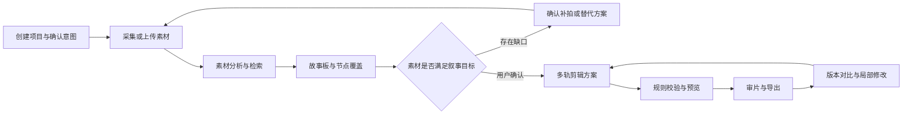

# ShadowWeaveAI · 影织 AI

**光影共创：多智能体驱动的主动感知与智能影像创作平台。**

影织 AI 面向校园生活、旅行、家庭与朋友记录、个人 Vlog、小型组织宣传五类场景，计划通过移动端拍摄指导和 Web 创作工作台，串联素材理解、故事规划、补拍、剪辑、审片与版本管理。

> **项目状态：仓库初始化 / 需求设计阶段。** 当前仓库包含需求基线、架构与开发文档、目录骨架和基础协作配置；尚未实现客户端、后端、模型接入和视频处理服务。下文功能与技术栈均为建设计划，当前没有可运行的产品演示或性能实测结果。

## 项目希望解决什么问题

- 拍摄时缺少构图、光线、角度和运镜指导，关键镜头容易遗漏。
- 照片、视频和音频分散，难以按人物、事件与表达目标定位素材。
- 素材充足但缺少故事结构，或故事已经确定却不知道还需要补拍什么。
- 局部修改容易影响字幕和声音，需要明确修改范围并保留已锁定内容。
- 成片问题难以定位，需要能关联片段、依据和作品版本的审片建议。

## 创作流程



用户可以选择补拍、替代片段、调整结构或略过节点。局部修改先展示差异与影响，经确认后保存新版本；已锁定内容需保持约束。

## 七大功能模块

| 模块 | 计划能力 | 状态 |
| --- | --- | --- |
| AI 智能摄影助手 | 实时画面分析、构图与光线检测、运镜建议、拍摄清单 | 待实现 |
| 智能素材管理中心 | 上传、关键帧与切镜、转写、标签、语义检索、质量与重复检测 | 待实现 |
| AI 创意工作台 | 文字与语音意图、主题、时长、风格、情绪及约束确认 | 待实现 |
| 多 Agent 智能导演中心 | 任务拆解、角色协作、依赖、执行监控、冲突与人工确认 | 待实现 |
| 智能故事板与补拍规划 | 大纲、分镜、节点关联、覆盖检查、补拍与时间预算 | 待实现 |
| AI 智能剪辑工作台 | 多轨时间轴、字幕旁白、声音、转场、预览导出与局部修改 | 待实现 |
| AI 审片与作品管理中心 | 叙事、重复、画质、同步与字幕检查，版本对比及恢复 | 待实现 |

## 七类 Agent

| 角色 | 主要职责 |
| --- | --- |
| 导演 | 拆解创作目标，协调角色与任务，处理冲突 |
| 编剧 | 生成故事大纲、叙事结构和旁白草稿 |
| 视觉 | 理解素材内容，评估候选镜头并保留来源证据 |
| 摄影 | 根据故事节点和现场信息生成拍摄与补拍建议 |
| 剪辑 | 生成满足时长、素材范围及锁定条件的时间轴方案 |
| 声音 | 安排旁白、音乐和环境音 |
| 审片 | 输出可定位、带依据的问题及修改建议 |

角色表示职责边界，可以共享模型和工具。模型结果需要经过结构校验与业务规则校验，不能直接触发媒体命令或越过用户确认。

## 计划技术栈

| 层次 | 选型 | 用途 |
| --- | --- | --- |
| 移动端 | Flutter、Camera API | 拍摄指导、补拍任务与素材回传 |
| Web 端 | Vue 3、TypeScript、Element Plus、Pinia | 素材、故事板、时间轴、审片与版本界面 |
| API | Python、FastAPI | 业务接口、校验、权限与状态同步 |
| 数据 | PostgreSQL、pgvector | 关系数据、版本和向量检索 |
| 后台任务 | Celery、Redis | 素材分析、渲染等耗时任务 |
| AI 编排 | LangGraph、可替换模型适配器 | 七角色工作流、检查点与模型调用 |
| 媒体处理 | FFmpeg、OpenCV、PySceneDetect、Librosa | 解析、分析、代理、音频与渲染 |
| 存储与部署 | S3 兼容对象存储、Docker Compose | 媒体对象存储与开发部署 |

具体依赖版本、模型服务和硬件要求将在各子项目初始化时验证并锁定。当前没有安装清单、锁文件或可执行部署配置。

## 仓库结构

```text
ShadowWeaveAI/
├── apps/
│   ├── web/                  # Vue Web 创作平台（预留）
│   └── mobile/               # Flutter 摄影与补拍端（预留）
├── services/
│   ├── api/                  # FastAPI 业务服务（预留）
│   └── worker/               # Celery 后台任务入口（预留）
├── packages/
│   ├── ai/                   # Agent、工作流与模型适配器（预留）
│   ├── media/                # 媒体分析、时间轴校验与渲染（预留）
│   └── contracts/            # 跨端数据契约与 Schema（预留）
├── docs/
│   ├── requirements.md       # 完整需求基线
│   ├── architecture.md       # 架构、职责与数据约束
│   ├── design/               # 系统详细设计、数据库设计、Agent 设计
│   ├── development.md        # 开发约定与初始化顺序
│   ├── roadmap.md            # 八阶段计划与验收产物
│   └── api/README.md         # 接口设计边界
├── infra/                    # 部署配置规划
├── scripts/                  # 自动化脚本规划
├── tests/                    # 跨服务集成与端到端测试规划
├── examples/                 # 授权样例与演示数据约定
├── .github/                  # Issue 与 Pull Request 模板
├── .env.example              # 计划环境变量；尚无程序读取
├── .editorconfig             # 编辑器格式约定
├── .gitattributes            # 文本换行约定
├── .gitignore                # 本地配置、构建与媒体产物排除
└── CONTRIBUTING.md           # 协作与提交约定
```

各业务目录目前以 README 说明职责与后续布局，尚无业务源码。`packages/` 是代码职责划分，目前没有配置为 npm、Python 或 Dart 工作区。

## 从这里开始

```shell
git clone https://github.com/Cyrene-06/ShadowWeaveAI.git
cd ShadowWeaveAI
```

1. 阅读 [需求分析](docs/requirements.md)，确认场景、需求编号与验收条件。
2. 阅读 [架构说明](docs/architecture.md)，了解服务边界及关键约束。
3. 阅读 [系统详细设计](docs/design/detailed-design.md)、[数据库设计](docs/design/database-design.md) 和 [Agent 设计](docs/design/agent-design.md)，按统一契约拆分实现。
4. 按 [开发指南](docs/development.md) 初始化对应子项目，并补齐依赖、启动方式和测试说明。
5. 参考 [开发路线](docs/roadmap.md) 和 [协作指南](CONTRIBUTING.md) 拆分任务。

当前可进行文档阅读和仓库协作；尚无 `npm run dev`、API 启动或 Docker 启动入口。`.env.example` 供后续配置设计参考，不需要在此阶段填写模型密钥。

## 开发计划与当前进度

需求基线计划由三人团队在 **2026 年 11 月 15 日至 2027 年 1 月 13 日**推进，涵盖基础平台、素材分析、事件理解、摄影指导、故事规划、七角色协作、剪辑重规划、测试交付八个阶段。该日期范围是项目内部计划，实际进度按提交和验收记录更新。

- [x] 整理完整需求基线与架构说明
- [x] 建立仓库目录骨架和协作配置
- [x] 编制系统详细设计、数据库设计与 Agent 设计草案
- [ ] 初始化 Web、Flutter、API 与后台任务工程
- [ ] 跑通创建项目 → 上传 → 样例分析 → 预览导出的首个闭环
- [ ] 完成七大模块及七角色协作
- [ ] 完成五类场景验证、故障恢复和交付材料

## 数据、模型与许可证

示例素材需记录来源及使用范围；原片、缓存、模型权重、导出视频和真实密钥不应直接进入 Git。模型型号、许可证与调用条款随实际接入补充。

当前仓库尚未选择开源许可证。公开可见不等于已经授予开源许可，复用与分发范围以未来明确添加的许可证为准。

需求基线：`YINGZHI-AI-V1.1.0-20261110-FULL-R01`。这是方案版本，不代表软件发布版本。
