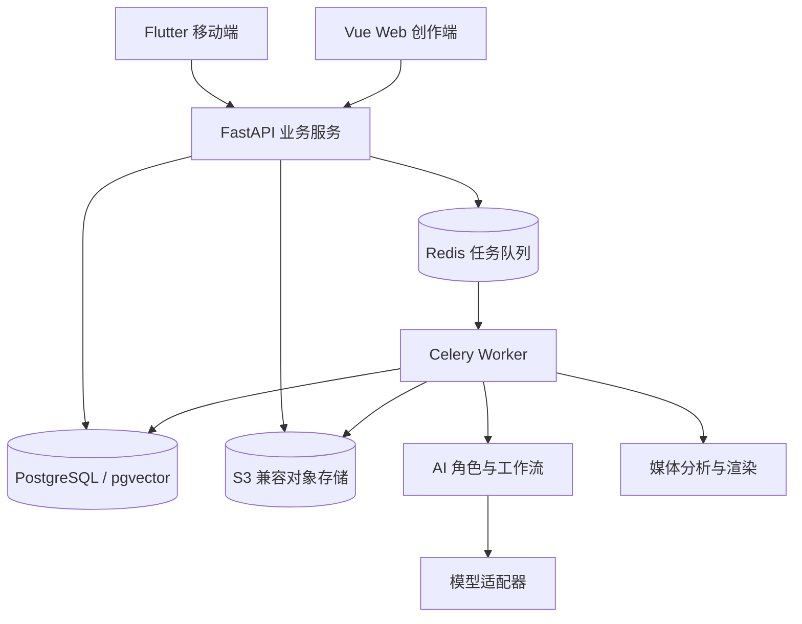

# 架构说明

本文依据需求基线描述拟采用的架构。当前只有目录与文档，尚无运行中的服务、数据库或模型工作流。

## 分层与依赖方向

计划由 API 暴露 HTTP 接口与 WebSocket 任务状态通道；长任务进入后台执行，客户端使用任务标识查询状态，并在断线后重新同步。WebSocket 是通知渠道，数据库保存的任务记录为状态依据。

| 目录 | 职责 | 依赖约束 |
| --- | --- | --- |
| `apps/web`、`apps/mobile` | 展示、用户确认、采集与上传 | 通过 API 访问业务，不直连数据库或模型服务 |
| `services/api` | 权限、项目、上传协调、任务、版本提交 | 通过队列派发耗时任务，不在请求中等待完整渲染 |
| `services/worker` | 消费任务，调度 AI 和媒体处理，保存产物 | 任务入口复用 packages 能力，避免复制业务逻辑 |
| `packages/ai` | 七角色、工作流、模型适配、提示和评测 | 输出结构化业务数据，不拼接媒体 shell 命令 |
| `packages/media` | 探测、代理、切镜、时间轴规则、渲染 | 接受校验过的参数，不依赖 Agent 内部实现 |
| `packages/contracts` | 跨端对象、Schema 与状态约定 | 保持与服务实现解耦；代码生成工具待确定 |
| `infra` | 本地依赖与部署配置 | 不包含业务逻辑或真实部署凭据 |

这些是源代码职责边界，不要求各角色部署为独立服务。Python 包路径、跨包引用和安装方式在初始化时统一确定。

## 核心对象

| 对象 | 关键内容 |
| --- | --- |
| Project / Intent | 项目、拥有者、主题、时长、风格、必留与禁用条件 |
| Asset / Segment | 来源、哈希、媒体参数、原片起止时间、转写及标签 |
| StoryNode / ReshootTask | 叙事目标、候选片段、覆盖状态、缺口及补拍记录 |
| Job | 角色、依赖、状态、检查点、配置、重试与错误 |
| Timeline / Clip | 轨道、来源区间、目标区间、转场、锁定与依赖 |
| ReviewIssue / Version | 问题位置、依据、父版本、差异、预览和导出产物 |

内部剪辑决策结构简称 EDL，是本项目的 JSON 数据约定，不承诺与外部编辑器格式兼容。具体字段、时基、枚举和 Schema 版本尚待冻结，见 [数据契约](../packages/contracts/README.md)。

## 七类 Agent 的协作

导演负责协调，编剧负责叙事，视觉负责素材理解，摄影负责采集建议，剪辑负责时间轴，声音负责音频安排，审片负责质量问题。完整职责见 [需求分析 6.5 节](requirements.md)。

各角色可以复用底层模型。工作流应显式保存依赖、输入输出、用户确认和检查点；格式修复、网络重试、时间与调用预算需要分别设置上限。不可满足的条件返回给用户处理。

## 任务状态

| 状态 | 含义 |
| --- | --- |
| `queued` | 已受理，等待执行 |
| `running` | 正在执行某阶段 |
| `waiting_user` | 需要用户确认、补充或解决冲突 |
| `succeeded` | 本次任务执行成功，产物可定位 |
| `failed` | 失败，保留原因与可重试信息 |
| `cancelled` | 已取消，保留记录 |

上传完成不等于分析完成，分析完成不等于成片导出完成。重试需记录次数和关联关系；相同幂等键的重复提交不得生成重复产物。幂等键计划关联项目、素材哈希、步骤、分析配置与模型版本。

## 必须保护的数据约束

1. 片段引用真实可用的原始素材，源时间范围合法且时长为正。
2. 时间轴总时长、轨道、转场重叠和字幕声音依赖经过校验。
3. 必留、禁用、锁定和用户确认均持久化；冲突时生成可解释的草案。
4. 已提交版本为可追溯快照。局部修改基于指定版本，经确认生成新版本；并发修改需要冲突检测。
5. 模型输出先经过 Schema 与业务校验；FFmpeg 使用参数数组和受控模板。
6. 素材中的文字和转写作为输入数据处理，不作为系统操作指令。
7. 项目、素材、任务与导出都校验访问权限；日志保留项目、任务、步骤、版本、耗时与错误类别，避免记录密钥。

## 尚待详细设计

鉴权方式、分片上传协议、数据库迁移、时间单位、任务检查点后端、部署端口、模型供应商及依赖版本均未确定。性能与效果以实际设备和数据集测量，不能由本架构图推导为已达成指标。
