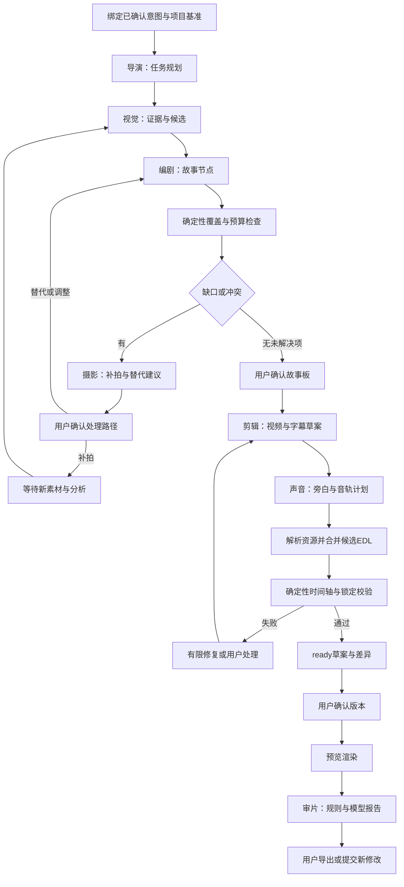

# 影织 AI Agent 设计文档

| 项目 | 内容 |
| --- | --- |
| 文档编号 | SWAI-AGD-R02 |
| 编制日期 | 2026-11-11 |
| 对应需求 | FR-AGT-001—008 及摄影、素材、故事、剪辑、审片相关需求 |
| 技术方向 | LangGraph + 可替换模型适配器 + 类型化工具 + PostgreSQL 检查点 |
| 文档状态 | 第二版实施设计草案；以核心闭环组织协作，尚无运行验证 |
| 配套文档 | [详细设计](detailed-design.md)、[数据库设计](database-design.md) |

## 1. 目标与职责边界

系统保留导演、编剧、视觉、摄影、剪辑、声音、审片七类专业职责，分别展示输入、执行状态、决策摘要、产物、依据与错误。角色可以共享同一个底层模型，工具计算可独立于模型完成；不以模型实例数或对话轮数证明协作效果。

首版采用受约束状态图：确定性编排器管理任务与提交，Agent 输出建议或结构化草案。任何角色都不能修改权限、直接提交作品版本、执行任意命令、删除素材、扩大预算或批准自己的建议。

Agent 设计目标是把“有素材但缺少故事”“故事缺口不知道补拍什么”“改一个镜头影响全部内容”转化为可解释、可确认和可恢复的操作流程。

### 1.1 核心闭环中的角色分工

[创新性分析](../innovation-analysis.md) 将证据覆盖和局部重规划列为创新假设，七角色是实现这些机制的职责接口。模型提出语义判断和候选，确定性组件控制合法性、传播、预算和写入。

| 闭环步骤 | 角色提出的业务建议 | 确定性组件负责 | 必留产物 |
| --- | --- | --- | --- |
| 意图→故事要求 | 导演/编剧提出节点、预算和顺序 | 用户确认、无环、时长与冲突检查 | Storyboard planning_context |
| 素材→覆盖判定 | 视觉给出带引用的事实支持与 unknown | EvidenceResolver 校验引用；CoverageEvaluator 按规则合成状态 | coverage_report、candidate refs |
| 缺口→行动 | 摄影给出动作、可行性条件和替代 | GapPlanner 可行性门/稳定排序，用户选择 | capture_task planning_context |
| 回传→验证 | 视觉复核新证据，导演建议更新故事 | 绑定 manifest/task revision 的验证 Job | verification_report、新故事修订 |
| 修改→局部方案 | 导演解析目标；剪辑/声音生成受限候选 | ImpactResolver 预报闭包，PolicyValidator 检查全量 diff/锁定 | impact_report、validation_report |
| 方案→版本→审片 | 审片提供问题和建议 | 人工门、API 事务、版本/导出分离 | EditDraft、Version、ReviewReport |

CoverageEvaluator、GapPlanner、ImpactResolver 是拟自研的规则/约束组件，可以作为注册工具调用；它们不再新增第八类 Agent。算法、边方向和状态表以 [详细设计第 7、8.3 节](detailed-design.md) 为准。

## 2. 运行时组件

| 组件 | 职责 | 持久化依据 |
| --- | --- | --- |
| WorkflowService | 创建运行、绑定权限与意图、预算、取消与恢复 | workflow_runs、jobs、outbox_events |
| GraphRunner | 按图执行节点、分支、fan-in、检查点 | LangGraph checkpointer + workflow 状态 |
| RoleRunner | 构建受限上下文、模型调用、解析、校验与修复 | agent_runs |
| ToolGateway | 参数 Schema、允许工具、项目域与成本校验 | job_events / audit_logs |
| EvidenceResolver | 获取当前可用素材、区间、转写和来源 | assets、segments、annotations |
| CoverageEvaluator / GapPlanner | 证据有效性、覆盖状态、缺口分类、可行性与任务排序 | coverage_report、capture_tasks.planning_context |
| ImpactResolver | 目标定位后的反向依赖闭包、约束扩展和原因报告 | edit_drafts.impact_report |
| PolicyValidator | 必留/禁用/锁定/时间范围/轨道/预算硬规则及独立全量 diff | 版本快照、规范化报告 |
| ApprovalService | 创建确认、校验决定、单次恢复 | approval_requests、Outbox |
| ModelProvider | 文本、视觉、转写、嵌入能力适配 | model_profiles 不可变修订 |

GraphRunner 和 RoleRunner 由 Worker 调用，HTTP 请求只提交任务。数据库为业务事实，检查点为图执行恢复位置；二者不假设共享同一事务。

## 3. 共享上下文与输入隔离

### 3.1 RunContext

所有角色接收服务端构造的不可变上下文：

| 字段 | 语义 |
| --- | --- |
| schema_version / graph_version | 共享契约与工作流实现版本 |
| project_id / workflow_id / job_id | 已鉴权且由服务端提供的范围 |
| intent_id / base_version_id / base_revision | 确认意图、可空基准版本和项目头修订 |
| role / model_profile_id / prompt_version | 角色与实际运行配置 |
| evidence_manifest_ref | 当前素材、分析批次、有效标注和对象清单引用 |
| constraints_ref | 必留、禁用、锁定及用户确认快照引用 |
| budget_remaining | 本次调用可用的调用数、token、时间、费用、帧数预算 |
| operation_key | 输入摘要、角色、节点、配置共同形成的幂等键 |

项目、用户、对象 ID 不允许从模型返回值替换 RunContext。工具仍要重新验证资源属于项目、素材未删、分析批次与绑定快照相符。一次工作流固定 evidence manifest；新规划默认绑定当前成功分析，既有版本局部修改可以读取其引用的旧批次。运行中 active_analysis 改变不静默替换已固定证据，补拍或纠错需显式更新 manifest 并重新验证受影响节点。

### 3.2 上下文裁剪

只提供当前职责需要的节点、片段、转写区间与候选证据；长转写使用引用和分段摘要，不将全部原片或完整项目历史塞入提示。检索结果记录 segment_id、analysis_run_id、asset_id、时间区间和 evidence_id。

素材中出现的系统命令、网页指令和“忽略规则”等文本按被引用内容隔离，不升级为系统或工具指令。角色只能调用 ToolGateway 注册工具，工具参数不允许任意 URL、文件路径或 shell 片段。

先前角色输出属于待校验业务数据，同样可能有错误，不因标注“导演建议”而越过硬规则。

## 4. 角色统一输入输出信封

### 4.1 输出结构

每次 RoleRunner 输出统一信封，模型只生成 result 内的业务字段；运行标识、usage 和 model 信息由运行时填充。JSON Schema 首版要求固定字段、类型与枚举，默认拒绝未知字段。

```json
{
  "schema_version": "1.0",
  "role": "camera",
  "status": "needs_confirmation",
  "result": {
    "capture_tasks": [{
      "task_key": "reshoot-ending",
      "node_key": "ending",
      "instruction": "拍摄同伴离开校园的背影，保持画面稳定",
      "purpose": "补充故事收尾",
      "suggested_duration_ms": 6000,
      "alternatives": ["使用已有校园远景并由用户确认"]
    }]
  },
  "evidence_refs": ["evidence-node-ending-missing"],
  "uncertainties": ["目前没有足够证据确认已有素材可表达告别"],
  "decision_summary": "结尾节点缺少可用画面，建议补拍并提供替代路径",
  "issues": [],
  "next_action": "request_gap_resolution"
}
```

信封 status：`ok`、`needs_confirmation`、`blocked`、`failed`。该状态只表达角色结果，不替代 Job 六态或 approval 状态。evidence_refs 必须可解析到已登记证据；引用不存在即校验失败。

### 4.2 角色输出字段摘要

| 角色 | result 必要字段 | 下游 |
| --- | --- | --- |
| director | task_plan、dependencies、required_approvals、constraint_summary | GraphRunner；只能选择白名单任务模板 |
| writer | story_nodes、narration_drafts、open_questions、time_budget_ms | 故事候选与摄影/剪辑 |
| visual | observations、candidate_matches、quality_findings、uncertainties | 素材标注、节点覆盖与审片 |
| camera | capture_tasks、field_hints、alternatives | 移动摄影与补拍确认 |
| editor | candidate_edl、change_targets、dependency_impact、conflicts | 确定性校验器与 EditDraft |
| sound | audio_plan、narration_texts、mix_constraints、resource_requirements | 音频素材生成与 EDL 合并 |
| reviewer | issues、checked_scopes、not_applicable、overall_summary | ReviewReport 与用户处置 |

字段 Schema 随 `packages/contracts` 实现。编剧中的时长必须满足全局毫秒规则；声音计划不能包含未登记音频的虚构 asset_id；剪辑输出不能直接视为通过校验的版本。

## 5. 七类角色详细设计

### 5.1 导演 Agent（director）

**输入**：用户确认的 Intent、当前项目阶段、素材分析摘要、已有故事板、版本约束、子任务执行状态与预算。

**处理**：从允许的工作流模板拆解任务，指定所需角色和前置产物；汇总冲突与缺失信息，提出可选方案。不能让模型任意构建可执行 DAG 或循环指令，编排器校验任务类型、边与最大迭代次数。

**输出**：task_plan、dependencies、required_approvals、constraint_summary；每项任务带角色、输入引用、预期产物与完成条件。

**允许工具**：读取项目状态、检索已完成任务结果、读取预算、请求确认草案。后者只创建建议，由 WorkflowService 实际写入 approval。

**禁止**：自行改变主题、忽略必留、解锁片段、提升调用额度、提交最终版本。冲突无法解决时返回 blocked，并列出用户可以选择的方案。

**验收**：依赖图可执行且无环；需要确认时停在正确边界；取消后不继续派发新角色；七角色参与记录与真实输出一致。

### 5.2 编剧 Agent（writer）

**输入**：确认意图、素材事件与转写摘要、已有节点、时长预算、明确真实与未知信息。

**处理**：生成主题、开端/过程/收尾等节点；为每个节点分配目的、镜头要求、情绪与时间预算；提供旁白草稿和未确定信息。

**输出**：story_nodes[{node_key,title,goal,requirements,budget_ms,required}]、narration_drafts、open_questions、time_budget_ms。

**允许工具**：片段检索、转写定位、节点预算检查。旁白需区分用户提供的事实、素材可支持的事实和创意表达，未经证据支持不得将推测叙述为真实发生的事件。

**失败处理**：预算不可满足时返回冲突，不用负时长或静默删除必需节点；证据不足返回 open_questions 或待补拍要求。

**验收**：节点有稳定键且总预算可校验；用户能理解结构与素材依据；事实类旁白可追溯到证据。

### 5.3 视觉 Agent（visual）

**输入**：受限关键帧/代理、片段范围、转写/OCR、规则质量结果、用户确认人物与标签。

**处理**：描述人物、动作、场景、事件候选和镜头适用性；为节点匹配候选片段。亮度/模糊等可计算指标优先使用工具，模型提供语义解释。

**输出**：observations、candidate_matches、quality_findings、uncertainties；每项观测包含 evidence_id、segment_id、范围、method、confidence 与 uncertain 标识。

**允许工具**：授权关键帧读取、转写读取、质量指标、同空间检索。抽帧数量、分辨率和原图访问均受预算限制。

**失败处理**：无清晰画面、多人身份不明、时间地点缺元数据时明确未知；回退基础标签和用户纠错，不默认推断真实身份。

**验收**：候选可定位原片；模型描述与可见证据关联；不同分析批次不混用；纠错后检索可解释。

### 5.4 摄影 Agent（camera）

**输入**：拍摄目标、故事缺口、当前场景信息、轻量画质/构图结果、设备可提供的能力。

**处理**：把缺口转成“拍什么、用途、如何拍、建议时长、替代方案”；针对现场状态提供简短提示。实时轻量指标运行在端侧工具链，云端语义调用不冒充实时本地性能。

**输出**：capture_tasks、field_hints、alternatives；每个补拍任务关联 node_key 和缺口证据。

**允许工具**：读取缺口、既有候选、轻量指标摘要、可用设备参数。不能远程控制摄像头自动录制，拍摄由用户操作。

**失败处理**：用户无法补拍时提供已有照片、环境音或结构调整方案，经用户确认；新素材上传后由视觉/覆盖检测重新判断，不由摄影角色自行标记 fulfilled。

**验收**：建议可执行且不只给笼统评价；无法补拍有可选路径；补拍回到原项目和节点；不会每帧调用云端模型。

### 5.5 剪辑 Agent（editor）

**输入**：确认故事板、候选区间、素材参数、目标时长、已有 EDL、锁定、依赖与局部修改目标。

**处理**：选择片段、安排顺序和轨道，生成裁剪、节奏、转场与字幕候选；局部修改限定影响集合。所有时间均为整数毫秒，源片段与目标时间轴分开。

**输出**：candidate_edl、change_targets、dependency_impact、conflicts，附素材选择与范围依据。

**允许工具**：读取 EDL、读取素材范围、计算依赖闭包、运行时间轴校验、估算时间预算。校验工具返回结果不能被角色标记“忽略后通过”。

**失败处理**：非法时间、缺失素材、锁定冲突与时长矛盾阻断草案 ready 状态；可以提出解锁或缩减范围建议，等待显式用户选择。

**验收**：每条媒体引用真实存在；锁定位置与内容保持；字幕声音依赖可见；草案显示差异并由用户确认新版本。

### 5.6 声音 Agent（sound）

**输入**：镜头节奏、字幕/原始语音、旁白草稿、已授权音乐与环境音、用户音量偏好、音轨约束。

**处理**：提出旁白文本、音轨放置、音量与淡入淡出；检测遮盖或衔接问题，提交资源需求。TTS 和转写是能力工具，不因角色名而假定已部署。

**输出**：audio_plan、narration_texts、mix_constraints、resource_requirements；计划引用已有 audio asset 或明确 pending 资源键。

**允许工具**：读取音频参数、转写、响度/节奏摘要、授权音频库查询；生成旁白只提出工具任务，由运行时按确认与预算执行。

**失败处理**：缺少授权音乐、未确认旁白或生成失败时返回可选无旁白/保留原声方案。pending 资源全部持久化为 Asset 后才可形成合法最终 EDL。

**验收**：声音来源可追溯；旁白用户可编辑；变更镜头长度可见地影响相关声音；主观音乐建议与确定性音频错误区分。

### 5.7 审片 Agent（reviewer）

**输入**：确认意图、故事节点、EDL、规则报告、预览、素材与转写依据。

**处理**：检查叙事完整性、重复、画质、同步、字幕与约束；分清确定性错误、可能问题和主观建议。规则校验器在模型前后均可执行，模型不能推翻硬错误。

**输出**：issues[{category,severity,location,evidence,confidence,suggestion}]、checked_scopes、not_applicable、overall_summary。

**允许工具**：时间轴规则、重复候选、字幕/转写对齐、可适用的音画偏移检测、抽样预览。同步工具不适用时明确原因，不输出无依据精确数值。

**失败处理**：报告部分可用但范围不全时标明未检查区域；修复建议只进入新的修改草案，不自动覆盖原作品。

**验收**：问题可跳转片段和区间；建议采纳与修复完成分开；再次检查新版本能关联原问题及处理记录。

## 6. 工具接口与权限矩阵

工具由服务端注册，具备 input_schema、output_schema、timeout_ms、资源成本、幂等类别和允许角色。每次调用记录 tool_call_id、agent_run_id、operation_key、耗时、错误与资源引用到 job_events；需要审计的动作进入 audit_logs。

| 工具族 | director | writer | visual | camera | editor | sound | reviewer |
| --- | --- | --- | --- | --- | --- | --- | --- |
| read_project / read_constraints | 允许 | 允许 | 摘要 | 摘要 | 允许 | 摘要 | 允许 |
| search_segments / read_evidence | 允许 | 允许 | 允许 | 允许 | 允许 | 音频域 | 允许 |
| read_keyframes / quality_metrics | 摘要 | 摘要 | 允许 | 受限 | 受限 | 不允许 | 允许 |
| read_transcript / audio_metrics | 摘要 | 允许 | 允许 | 摘要 | 允许 | 允许 | 允许 |
| read_timeline / dependency_closure | 摘要 | 摘要 | 不允许 | 不允许 | 允许 | 允许 | 允许 |
| validate_timeline / budget_check | 允许 | 预算 | 不允许 | 不允许 | 允许 | 音频计划 | 允许 |
| propose_capture / propose_approval | 允许 | 提出缺口 | 提出证据 | 允许 | 允许 | 允许 | 提出建议 |
| commit_version / delete_asset / shell | 禁止 | 禁止 | 禁止 | 禁止 | 禁止 | 禁止 | 禁止 |

“提出”工具返回可持久化建议，实际副作用由编排器经业务服务执行。渲染、上传发布、确认决定和成员管理不作为模型可直接执行的工具。

工具读取固定的 project_id 与用户/服务身份，用户输入的 asset_id/segment_id 需再次验证。相同 operation_key 的副作用工具通过业务唯一键去重；纯读取工具可以缓存，但素材权限与删除状态每次重新校验。

## 7. 主创作工作流



首次素材分析可在工作流前执行并复用；编排中视觉角色仍需有真实候选解释记录。若已有已确认故事板与版本，图可以从对应安全阶段进入，不能为展示七个名字而无意义地重复调用。

声音若产生待生成资源，运行时先执行受控生成/入库任务，再合并 EDL。原片音频可单独抽取为 audio Asset，工具保存源引用；不把视频 asset 直接写入只接受 audio 的声音轨。

缺口循环每次都与新的素材或用户选择关联。没有新输入不得自动重复分析；用户拒绝补拍或调整后可明确结束当前工作流，不能无限兜圈。

## 8. 专项工作流

### 8.1 摄影指导

Flutter 本地轻量分析 → 条件变化/用户请求 → 服务端摄影建议 → 简短提示或任务卡。云端调用有冷却和帧预算，相同场景摘要复用结果，用户可关闭提示；每帧画面不写入数据库。云端断开后保留端侧能力与待上传任务。

### 8.2 补拍更新：证据闭环

1. 视觉角色输出每项故事要求的 supported/contradicted/unknown 与片段/帧/转写引用；不得只给一个置信度数字。
2. CoverageEvaluator 先检查 manifest、搜索完整性和引用，再按详细设计的有序规则计算状态；检索失败或预算截断返回 uncertain，不报 missing。
3. 摄影角色接收真实缺口及用户条件，提出拍摄动作、理由、时长、可执行条件与替代。GapPlanner 先排除不可执行任务，再按固定策略排序；导演不能把已结束活动改写为可再发生。
4. 用户确认任务后 Flutter 采集/上传；上传只得到 submitted。新 Asset 分析成功后定位原 node_key，创建新故事修订并执行验证 Job。
5. 写回检查 task revision 与租约。验证报告引用新 manifest、候选和故事修订；合格支持才 fulfilled。已有成片不自动替换，需新的 EditDraft 和版本确认。

结构冲突回到约束确认；事实未知回到证据核对。两者均不能只因故事“缺一段”就强制用户补拍。用户 unable 或略过保留决定，不标为 covered。

### 8.3 局部修改：先预报影响再生成候选

1. 绑定 base_version_id、base_revision、基准内容哈希、目标与锁定集；目标同名或“更温暖”等范围不明时等待确认。
2. 导演只解析操作目标与约束，不能自行批准扩大范围或解锁。ImpactResolver 用 prerequisite→dependent 方向传播，叠加重叠、顺延、节点预算与全局条件，形成 predicted_affected_keys 及原因链。
3. 将目标与连带变化展示给用户；超出原授权的范围或全片扩展要先确认，锁定冲突返回替代方案。该批准只授权范围，不替代最终草案确认。
4. 剪辑/声音角色仅接收已批准影响子图及边界条件。边界外片段保持基准快照；不能通过生成新键删除旧锁定片段。
5. 独立校验器比较整个候选 EDL：源范围、时长、依赖、必留/禁用、锁定 hash，actual_changed_keys 必须属于已授权预报集合。扩大范围则返回新的影响报告再确认，不原地补写已批准报告。
6. 无硬错误才保存 ready 草案、impact_report、实际 diff、requested_unlock_clip_keys 与 payload_hash。最终确认的 unlock_clip_keys 必须一致；API 事务创建 Version。

范围授权和最终草案确认是不同目的的确认：前者使用 approval_requests.kind=edit_scope，后者使用 edit_drafts 的确认事务，不额外创建可直接发布版本的 Agent approval。两个门均绑定基准与摘要、检查过期，恢复步骤须可重入。范围没有扩大时无需制造额外确认，用户原始明确目标可作为范围授权依据。

先验收等长开场替换、字幕锚定与边界转场，再加入声音与全局时长约束。全片依赖可能使影响集合覆盖全部内容，应明确报告；20 秒目标针对索引已完成的等长开场替换，不含最终视频编码。

### 8.4 审片修复

报告 → 用户采纳某问题 → 新 local_edit 工作流 → 草案/确认 → 新 Version → 重新审片验证。原报告不改成“曾经没有问题”；review_issues.resolution 引用验证版本或新报告。

## 9. GraphState 与状态转换

GraphState 保留可序列化的小型状态与引用：workflow_id、graph_version、schema_version、intent_ref、base_ref、phase、input_manifest_hash、storyboard_ref、draft_ref、review_ref、pending_approval_ids、completed_operation_keys、budget_snapshot、last_error。

不在检查点中保存数据库连接、模型客户端、原片字节、完整音频、密钥或本地临时路径。并行分支写入不同键，汇总节点校验所有必需输出；集合合并按稳定键去重，避免恢复时重复追加节点。

| 状态变化 | 条件 |
| --- | --- |
| queued → running | 获得有效租约且依赖满足 |
| running → waiting_user | 已持久化确认请求和检查点引用 |
| waiting_user → queued | 合法决定已提交，通过 Outbox 调度恢复 |
| running → succeeded | 所需结构化产物已保存，不代表已导出 |
| running/queued → failed | 超过重试/预算、硬错误或不可恢复依赖 |
| queued/running/waiting_user → cancelled | 取消已受理，阶段边界停止与等待项作废 |

基础设施暂态重试可从 running 回 queued，同时保留 attempt 和事件；终态用户 retry 新建 Job。Workflow 状态汇总必需 Job，不能因一个角色 succeeded 就提前完成整个创作流程。

## 10. 检查点、人工中断与恢复

每个 workflow_runs 使用唯一稳定 thread_id，检查点保存在 PostgreSQL checkpointer；环境、graph_version 和 checkpoint 命名空间隔离。重启后以数据库业务记录及 checkpoint_ref 共同核对，不依赖内存 MemorySaver 提供持久恢复。

LangGraph interrupt 恢复可能从节点开头重新执行，因此中断前动作必须幂等。设计将节点拆分为：准备候选 → 幂等写 approval → interrupt 等待 → 校验已存决定 → 幂等应用决定。不要在 interrupt 前发送不可去重的外部请求或提交 Version。

确认处理：

1. ApprovalService 在一个 DB 事务中检查成员权限、pending、hash、基准与有效期，保存决定和唯一 resume Outbox。
2. 恢复 Worker 领取租约，读取决定和当前 checkpoint，使用选定 LangGraph 版本的恢复接口；客户端不直接提交 arbitrary resume payload。
3. 节点从业务记录读取决定，按 approval_id 与 operation_key 去重；重复 Outbox 不重复应用。
4. 业务已提交而检查点未写时，节点读取已完成资源并前进；检查点已前进但业务未提交时，补做可重入事务。
5. 并发修改、素材删除或配置不兼容导致旧确认无效时，标为 invalidated 并生成新草案或明确失败。

检查点、业务库和外部模型调用无法靠本设计保证跨系统 exactly-once。外部请求超时但实际可能完成时，优先利用 provider_request_id 查询；不支持查询时保留 uncertain 调用与可能费用，再进行有上限重试。

图代码升级需验证 checkpoint 兼容。运行中 workflow 固定 graph_version；不兼容升级不能直接用新图恢复旧状态，应保留旧执行器或明确迁移并记录用户影响。

## 11. 模型适配、提示与结构校验

### 11.1 Provider 契约

适配器能力分 `generate_text`、`analyze_frames`、`transcribe`、`embed` 和可选 `synthesize_speech`。实际 Provider 只声明经验证的能力，不能因接口名称相同就假定支持图文对齐或严格 JSON。

请求包括 model_profile、messages/受控媒体引用、output_schema、timeout、token/帧上限、operation_key。响应统一提供 structured_output、usage、latency_ms、provider_request_id 和可重试错误分类。业务不依赖某个品牌的聊天返回结构。

网络端点和 secret_ref 由服务端配置解析，模型不接触 API key。模型、参数或预处理变化产生 profile revision，并参与缓存键与评测记录。

### 11.2 提示分层

- 系统层：角色职责、允许工具、事实/不确定性、禁止直接执行和 Schema 约束。
- 项目层：已确认意图、锁定/必留/禁用和预算。
- 任务层：当前目标、允许修改范围和可用证据。
- 数据层：带来源的素材摘要、转写与前序结果，明确作为数据引用。

模板按角色、版本和变量清单管理，禁止在生产运行中直接覆盖旧模板内容而不增加 prompt_version。日志保存模板版本与输入摘要，是否保存脱敏模型原文另行配置，不保存隐藏推理。

### 11.3 校验和修复

解析 JSON → Schema/未知字段 → 引用与权限 → 语义规则 → 硬约束 → 产物保存。格式错误最多允许一次约束修复，附具体字段错误和原任务约束；引用伪造、权限失败和锁定冲突不能通过“再让模型解释”直接放行。

硬规则如源范围、时长、已锁内容由确定性程序执行；叙事、风格和镜头美感是可拒绝建议。错误和建议分别在 UI 呈现。

## 12. 预算、超时、重试与成本

以下是首轮实验的**可配置起点**，不是已测性能或固定产品限额；每个工作流保存实际配置和变更记录。

| 项目 | 初始策略 |
| --- | --- |
| 单模型调用超时 | 文本 45 秒，视觉/长语音按能力单独配置 |
| 网络重试 | 最多额外 2 次；仅对超时、429 和可恢复 5xx，指数退避加抖动 |
| Schema 修复 | 每个原始输出最多 1 次，计入总调用与 token |
| 自动规划修订 | 最多 2 轮；仍有冲突转用户，不无限互评 |
| 并行角色数 | 初始 2，按资源与提供商限制验证后调整 |
| 完整工作流模型请求 | 上限初始 30 次，含重试/修复，用户补拍后可显式创建续程预算 |
| 局部修改模型请求 | 上限初始 6 次，不能用请求次数代替 20 秒规划目标 |
| 金额和 token | 必须由实际 model profile 与团队预算配置，未配置收费额度时不启动付费调用 |
| 等待用户 | 不占 Worker，超过 approval 有效期后过期/失效，等待时长单独统计 |

并行节点先锁 workflow_runs 预留预算，调用完成结算实际 usage，失败也记录已发生或未知费用；不能让每个分支读取同一“余额”后独立超支。达到上限生成 BUDGET_EXCEEDED 与明确用户选项，Agent 无权自行增加预算。

重试后重新校验租约和取消状态，旧 Worker 迟到结果不可提交。外部模型无法取消时停止后续步骤，并记录可能仍发生的调用费用。

缓存键包含角色、prompt_version、Schema、输入证据哈希、意图/版本约束、模型 profile 与参数。不同项目的个人素材输出不默认跨项目共享缓存。

## 13. 冲突、降级与错误策略

| 情况 | 处理 |
| --- | --- |
| 素材无音轨/语音过少 | 转写 not_applicable，继续视觉与用户文本 |
| 视觉模型不可用 | 保留规则指标和基础标签，允许手工补充，标明降级 |
| 检索候选不足 | 精确/关键词回退，或输出 missing，不虚构片段 |
| 时长与必留/锁定冲突 | 展示冲突和影响，等待用户选方案 |
| 音乐缺授权或旁白未确认 | 阻止该资源生成/使用，提供保留原声路径 |
| 模型输出格式反复错误 | 一次修复后失败，保存错误和可编辑草案 |
| Worker 重启/租约丢失 | 按检查点与 operation_key 恢复，拒绝旧 lease_token |
| 用户取消 | 作废 pending approval，停止新调用，保留历史版本 |
| 项目删除或权限撤销 | 中止后续访问与发布，按清理任务处理临时产物 |
| 审片不适用/无证据 | 标记 not_applicable 或待复核，不报告“通过” |

## 14. 可解释性、追踪与隐私

每次角色调用可查看 role、input_refs、prompt/model revision、工具摘要、output、decision_summary、evidence_refs、uncertainties、usage 和 error。展示“为什么选这个片段”的业务依据，不依赖暴露模型隐藏推理。

agent_runs 与 Job/Workflow/Version 关联，关键用户选择写 audit_logs。素材中含个人信息时只按必要区间提供给已选择的模型能力，外部处理策略在实际接入时确认；测试集需授权与去标识化说明。

指标分别统计成功率、Schema 失败率、工具错误、重试、等待用户、重复复用、tokens、费用、节点耗时与用户拒绝原因；不能只展示成片成功率掩盖无法恢复和超支。

## 15. 评测数据与验收

### 15.1 数据集、机制与角色分离验证

五类场景每类 3 个任务、每任务至少 20 段素材，即 15 组、至少 300 段，是待建设目标。按来源计划每场景 1 组开发、2 组冻结测试；同一事件的原片、裁剪和近重复不跨集合。尚无数据采集或实验结果。

[评测协议](../evaluation.md) 统一基线、消融、指标分母和失败记录。机制比较保持角色布局一致；角色比较保持证据覆盖、局部传播、校验和人工门一致。两侧使用相同基础模型与预算上限，报告实际用量与超预算失败，不能以七角色允许更多调用来证明分工有效。

### 15.2 角色与流程验收表

| 范围 | 核心检查 | 证据 |
| --- | --- | --- |
| 导演 | DAG 正确、依赖满足、冲突会等待 | 任务图、事件、approval |
| 编剧 | 节点完整、预算、事实依据 | 故事板修订、引用与人工评价 |
| 视觉 | 区间可追溯、检索召回、纠错生效 | 标注集、候选与区间命中 |
| 摄影 | 建议可执行、补拍有效、无法补拍路径 | 真机任务与节点更新 |
| 剪辑 | 合法 EDL、锁定、范围外保持 | 校验报告、规范化 diff/hash |
| 声音 | 资源授权、字幕/声音范围、旁白可编辑 | 音频 Asset、轨道与预览 |
| 审片 | 问题定位、误报漏报、适用性 | 标注问题、报告与用户处置 |
| 工作流 | 中断恢复、重复决定、取消、预算 | 故障注入记录与业务唯一性 |

必要故障注入：模型返回假 asset_id、素材转写含操作指令、429 后重试、预算并发、确认后 graph 崩溃、恢复节点重复执行、旧租约提交、锁定片段顺延、被删素材引用和输出 Schema 升级不兼容。

### 15.3 指标口径

检索报告区间级 Recall@K 与所用真值范围；缺口检测报告节点级精确率/召回及 uncertain 处置；局部修改报告范围外变更数和锁定违规数；恢复报告重复业务资源数与丢失已确认决定数。硬约束目标是零违规，属于待实现验收标准。

效果、性能、费用和用户主观评价分开。性能沿用需求中的 P95 目标并注明硬件、模型配置、样本量和等待边界。所有结果记录 dataset_version、code_commit、graph/prompt/model/schema 版本与实际参数，当前无实测数值。

## 16. 实现批次与待定事项

1. 实现类型契约、纯读取工具和确定性校验器，用明确标识的固定结果验证编排。
2. 建立 PostgreSQL checkpointer、thread_id、Job/Outbox、人工中断及故障恢复。
3. 接入一个验证过的模型，完成导演、编剧、视觉的最小故事证据链。
4. 接入摄影补拍、剪辑 EDL、声音资源与审片，形成七角色完整证据。
5. 完善真实预算、缓存、真机与场景评测；局部依赖传播和锁定内核在第 1 批即用固定样例验证，不等到所有角色接入才评估可行性。

仍需验证：LangGraph/checkpointer 具体版本、图状态迁移策略、模型对 Schema 与视觉/转写的真实能力、向量空间、收费配置和端侧性能。完成验证后增加修订号并更新 model_profiles 与开发文档。

## 17. 官方技术依据

于 2026-11-11 核对以下官方机制，实际实现仍需按锁定版本验证：

- LangGraph 持久化、thread 与 checkpoint：<https://docs.langchain.com/oss/python/langgraph/persistence>
- LangGraph interrupts、恢复时节点重执行与幂等副作用：<https://docs.langchain.com/oss/python/langgraph/interrupts>
- Celery 幂等任务、acks_late 与进程异常下的确认行为：<https://docs.celeryq.dev/en/stable/userguide/tasks.html>

本设计不依赖简单设置 acks_late 即可可靠恢复，仍需要业务租约、幂等、Outbox 与故障验证。七角色 Schema、预算、审批、来源约束和局部修改规则是本项目设计，尚未实现。
