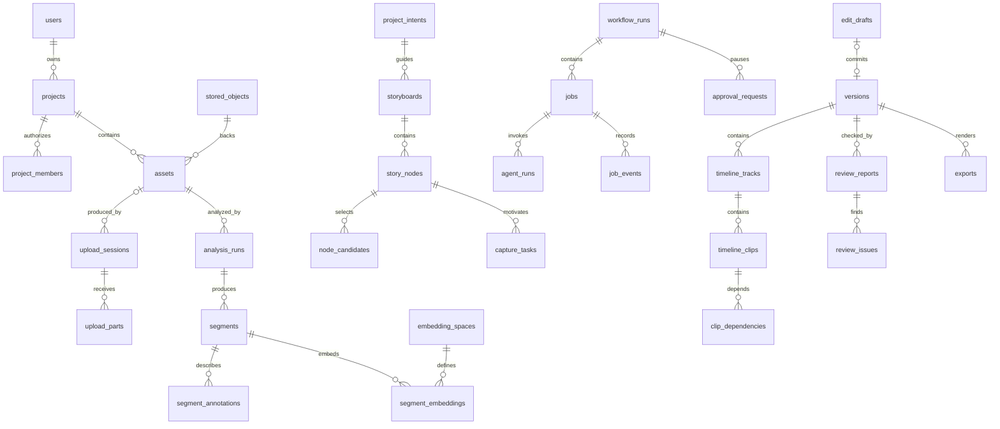

# 影织 AI 数据库设计文档

| 项目 | 内容 |
| --- | --- |
| 文档编号 | SWAI-DBD-R02 |
| 编制日期 | 2026-11-11 |
| 需求基线 | YINGZHI-AI-V1.1.0-20261110-FULL-R01 / SRS-R01 |
| 数据库方向 | PostgreSQL + pgvector；Redis 为队列/短缓存；媒体进对象存储 |
| 文档状态 | 第二版逻辑与物理设计草案；尚无迁移脚本、已建表或运行验证 |
| 配套文档 | [详细设计](detailed-design.md)、[Agent 设计](agent-design.md) |

## 1. 范围和存储边界

PostgreSQL 保存身份与项目权限、上传记录、媒体元数据、分析证据、故事快照、任务状态、Agent 调用、用户确认、作品版本和审计。对象存储保存原片、代理、缩略图、转写大文件、生成音频、检查点大对象和导出文件。Redis 不承担唯一业务状态、版本或授权存储。

业务表首版为 **36 张**，按下述字典设计；LangGraph 官方 PostgreSQL checkpointer 的内部表由选定适配器单独迁移，放在 `agent_checkpoints` schema，不计入 36 张业务表，也不手写模拟其表结构。默认业务 schema 为 `public`，后续可用独立 schema 隔离。

### 1.1 核心机制需要保存的事实

[创新性分析](../innovation-analysis.md) 不依靠表数量证明技术贡献。R02 保持 36 张业务表，通过明确字段和不可变引用支撑两个闭环。

| 机制事实 | 表/字段 | 为什么需要持久化 |
| --- | --- | --- |
| 规划依据和证据边界 | storyboards.planning_context；analysis_runs、annotations | 可以复核判定使用哪批素材、人工标注、规则与顺序关系 |
| 覆盖判定而非一个颜色标签 | story_nodes.coverage_report；node_candidates.evidence | 区分无素材、质量不足、语义未知和检索未完成 |
| 补拍可行性和真实成效 | capture_tasks.planning_context / evidence | 上传、分析、覆盖验证和任务 fulfilled 分别有依据 |
| 目标、传播理由与实际差异 | edit_drafts.impact_report / diff | 避免求解后才用扩大范围解释所有变化 |
| 锁定及范围外保持 | timeline_clips、clip_dependencies；draft validation_report | 保留基准和候选规范化比较结果 |
| 结果可复现 | workflow_runs、agent_runs + 离线评测 manifest | 数据、模型、预算、提交和原始指标可关联；不增加仅用于展示创新的表 |

评测数据集和报告属于离线工件，格式见 [评测协议](../evaluation.md)；若将来产品化为在线评测服务，再单独设计评测表与迁移。

## 2. 命名、类型与共同字段

除非表内另行说明，所有表都有：`id uuid PRIMARY KEY`、`created_at timestamptz NOT NULL DEFAULT now()`。可变表另有 `updated_at timestamptz NOT NULL DEFAULT now()`，由统一服务或触发器更新。字段表中的“可空”以外默认 NOT NULL；没有明确默认值的字段必须显式提供。

| 约定 | 设计 |
| --- | --- |
| 标识 | API 生成 UUID，DB 原生 uuid；禁止用递增 ID 推断访问权限 |
| 时间 | UTC timestamptz；媒体区间 bigint 毫秒半开区间 |
| 状态 | text + CHECK 允许值；首版避免难回退的原生 ENUM |
| 哈希 | 小写十六进制 SHA-256，char(64) 并检查格式 |
| 金额 | numeric(18,6) 非负 + currency，API 使用十进制字符串 |
| 置信度 | real，CHECK 0 <= value <= 1；未知可空 |
| 结构化配置 | jsonb；检查 object/array 类型和大小，Schema 校验由应用完成 |
| 媒体对象 | 外键 stored_objects；不保存永久公开 URL |
| 可变实体修订 | revision integer >= 1，用于比较并交换 |
| 软删除 | deleted_at timestamptz 可空；历史引用保留，不对所有表机械添加 |

项目域表均包含 `project_id uuid` 并外键到 projects；除 upload_parts 等明确经父表继承作用域者外，增加 `UNIQUE(project_id,id)`，以便建立复合外键。任何项目域子对象引用另一个项目域对象时，必须使用 `(project_id,parent_id) → parent(project_id,id)`，禁止只校验 UUID 存在。projects 本身的 `id` 即项目域。

版本轨道/片段等更强归属关系需增加 UNIQUE(project_id,version_id,id)、UNIQUE(project_id,version_id,clip_key) 等被引用组合；segments 与 analysis_runs 同样建立带 asset_id 的唯一组合。具体外键必须引用父表已有的唯一键，不能只在应用中口头约定。

关系索引不是所有外键自动获得：按查询与删除检查显式建立。默认 ON DELETE RESTRICT，物理清理按引用顺序执行；仅不具有独立生命周期的临时子记录可审慎使用 CASCADE。审计和历史记录不能随普通素材删除级联清空。

## 3. 实体关系与表清单



图只展示主要关系，完整外键及辅助表以下文为准。

| 分组 | 表 |
| --- | --- |
| 身份项目（5） | users、auth_sessions、projects、project_members、project_intents |
| 存储与分析（8） | stored_objects、upload_sessions、upload_parts、assets、analysis_runs、segments、segment_annotations、embedding_spaces |
| 检索故事（5） | segment_embeddings、storyboards、story_nodes、node_candidates、capture_tasks |
| 编排与确认（6） | workflow_runs、jobs、job_dependencies、job_events、agent_runs、approval_requests |
| 编辑与作品（7） | edit_drafts、versions、timeline_tracks、timeline_clips、clip_dependencies、review_reports、review_issues |
| 导出配置与运维（5） | exports、model_profiles、api_idempotency、outbox_events、audit_logs |

## 4. 表结构字典

### 4.1 users — 用户

可变；共同字段外含 updated_at。

| 字段 | 类型/默认 | 含义与约束 |
| --- | --- | --- |
| email | varchar(254) | 规范化邮箱，唯一；首版转小写规则在 API 固定 |
| password_hash | text | Argon2id 哈希，不存原始密码 |
| display_name | varchar(80) | 展示名称 |
| status | text / active | active、disabled、deleted |
| deleted_at | timestamptz，可空 | 逻辑删除时间 |

索引：UNIQUE(email)。用户删除先转移/删除拥有项目、撤销会话，再按保留策略清理，不自动级联删除作品。

### 4.2 auth_sessions — 刷新会话

可变；含 updated_at。

| 字段 | 类型/默认 | 含义与约束 |
| --- | --- | --- |
| user_id | uuid | FK users |
| token_hash | char(64) | 随机刷新令牌摘要，唯一 |
| family_id | uuid | 轮换会话链标识 |
| replaced_by_id | uuid，可空 | 自引用，轮换后的会话 |
| expires_at | timestamptz | 有效期 |
| revoked_at | timestamptz，可空 | 撤销时间 |
| client_kind | text | web、mobile |
| last_seen_at | timestamptz，可空 | 最近刷新时间 |

索引：UNIQUE(token_hash)、(user_id,expires_at)、(family_id)。轮换在事务中撤销旧行并插入新行，旧令牌再次使用时撤销 family 并要求重新登录。

### 4.3 projects — 创作项目

可变；含 updated_at。

| 字段 | 类型/默认 | 含义与约束 |
| --- | --- | --- |
| owner_id | uuid | FK users，唯一 owner 来源 |
| name | varchar(120) | 项目名称 |
| scenario | text | campus、travel、family_friends、vlog、organization |
| status | text / active | active、archived、deleting、deleted |
| current_intent_id | uuid，可空 | 复合引用本项目 confirmed 意图 |
| current_version_id | uuid，可空 | 复合引用本项目 Version |
| revision | integer / 1 | 项目名称、状态与成员变更并发检查；相关变更递增 |
| head_revision | integer / 0 | >=0，每次版本头更新递增 |
| event_seq | bigint / 0 | >=0，按项目行锁分配项目事件序号 |
| deleted_at | timestamptz，可空 | 访问撤销时间 |

索引：(owner_id,created_at DESC,id) WHERE deleted_at IS NULL。两个 current 外键在后续迁移中补建以解决建表环；确认状态和同项目条件需事务/复合外键联合验证。

### 4.4 project_members — 协作成员

可变；含 updated_at。

| 字段 | 类型/默认 | 含义与约束 |
| --- | --- | --- |
| project_id | uuid | FK projects |
| user_id | uuid | FK users |
| role | text | editor、viewer；owner 不重复存此表 |
| added_by | uuid | FK users |

索引：UNIQUE(project_id,user_id)、(user_id,project_id)。增删成员事务锁定项目并校验 owner，防止把 owner 再写入普通成员角色。

### 4.5 project_intents — 意图修订

draft 可编辑，confirmed 后不可变；含 updated_at。

| 字段 | 类型/默认 | 含义与约束 |
| --- | --- | --- |
| project_id | uuid | 项目域 |
| revision | integer | UNIQUE(project_id,revision) |
| source_text | text | 用户原文/语音确认后的转写 |
| target_duration_ms | bigint | >0 |
| output_config | jsonb | 画幅、输出尺寸与有理帧率 |
| creative_config | jsonb | 主题、风格、情绪、重点人物 |
| constraints | jsonb | 必留、禁用和特殊要求，含来源 |
| unresolved | jsonb / [] | 未解决冲突与缺失字段 |
| status | text / draft | draft、confirmed、superseded |
| confirmed_by / confirmed_at | uuid / timestamptz，可空 | FK users；成对非空 |

superseded 只标记状态，已确认内容仍不可改。全文“确认快照”包括 confirmed 及具有 confirmed_at 的 superseded 历史修订，不能因其不再是当前意图而使历史版本失去合法引用。确认必须 unresolved 为空或有明确用户处置，更新项目当前意图不改变正在运行任务的 intent_id。

### 4.6 stored_objects — 存储对象

可变状态；含 updated_at。

| 字段 | 类型/默认 | 含义与约束 |
| --- | --- | --- |
| project_id | uuid | 项目域 |
| bucket / object_key | text / text | UNIQUE(bucket,object_key)，服务端生成 |
| kind | text | original、proxy、thumbnail、transcript、generated_audio、render、checkpoint、planning_artifact、verification_report |
| state | text / pending | pending、available、deleting、deleted、failed |
| sha256 | char(64)，可空 | 上传校验前可空；available 时必须具备摘要 |
| size_bytes | bigint，可空 | >=0；available 时非空 |
| mime_type | varchar(120)，可空 | 服务端探测 |
| storage_version | text，可空 | 存储后端版本号，如可用 |
| producer_job_id | uuid，可空 | 同项目 jobs，建表后补 FK |
| deleted_at | timestamptz，可空 | 墓碑 |

available 对象内容不可覆盖，只能创建新键。外部媒体 URL 不能填入 object_key 作为可执行路径。

### 4.7 upload_sessions — 上传会话

可变；含 updated_at。

| 字段 | 类型/默认 | 含义与约束 |
| --- | --- | --- |
| project_id / uploader_id | uuid / uuid | 项目、FK users |
| original_name | varchar(255) | 仅显示，不作为路径 |
| declared_size_bytes | bigint | >0，低于实际部署上限 |
| declared_sha256 | char(64)，可空 | 客户端摘要，仅供校验 |
| part_size_bytes | integer | >0，服务端决定 |
| backend_upload_id | text | 对象存储 multipart 标识 |
| temp_object_id | uuid | 同项目 stored_objects |
| capture_task_id | uuid，可空 | 同项目 capture_tasks |
| complete_job_id | uuid，可空 | 同项目 jobs |
| asset_id | uuid，可空 | 完成后资产，允许不同会话命中同一去重资产 |
| state | text / initiated | initiated、uploading、completing、completed、failed、aborted、expired |
| expires_at | timestamptz | 过期时间 |
| failure_code | text，可空 | 稳定错误码 |

索引：(project_id,uploader_id,created_at)、(expires_at) WHERE state IN ('initiated','uploading')。completed 必须 asset_id 非空；不能对 asset_id 加会话级唯一约束，否则同项目去重会失效。

### 4.8 upload_parts — 分片记录

例外：无独立 UUID 与 created_at；PK(upload_session_id,part_no)，含 updated_at，通过会话继承项目域。

| 字段 | 类型/默认 | 含义与约束 |
| --- | --- | --- |
| upload_session_id | uuid | FK upload_sessions |
| part_no | integer | >0 |
| size_bytes | integer | >0 |
| etag | text | 对象存储确认值，不代表完整 SHA-256 |
| checksum | text，可空 | 若后端提供可核验校验和则记录 |

API 必须从已授权的项目和上传会话定位分片。记录来自对象存储确认，不能只相信客户端已上传声明。

### 4.9 assets — 媒体素材

可变状态；含 updated_at。

| 字段 | 类型/默认 | 含义与约束 |
| --- | --- | --- |
| project_id / creator_id | uuid / uuid | 项目、FK users |
| original_object_id | uuid | 同项目 available 对象 |
| media_type | text | video、image、audio |
| origin | text | upload、generated |
| sha256 | char(64) | 原始媒体实际摘要 |
| duration_ms | bigint，可空 | video/audio >0；image 为 NULL |
| width / height | integer，可空 | >0，音频可空 |
| fps_num / fps_den | integer，可空 | >0 的有理帧率，视频适用 |
| audio_info | jsonb / {} | 采样率、声道、音轨等探测结果 |
| captured_at | timestamptz，可空 | 已知拍摄时间；不等于 created_at |
| source_metadata | jsonb / {} | 设备、旋转、已知地点与元数据来源 |
| license_info | jsonb | 来源、授权范围、用户声明，不存授权私密文件正文 |
| active_analysis_id | uuid，可空 | 同项目且属于该 Asset 的成功分析 |
| state | text / ready | ready、unavailable、deleted |
| deleted_at | timestamptz，可空 | 删除时间 |

索引：UNIQUE(project_id,sha256) WHERE deleted_at IS NULL；(project_id,created_at DESC,id)。active_analysis 属于本 Asset 的约束通过复合 (project_id,id,asset_id) 引用或触发器实现，不能只校验同项目。

### 4.10 analysis_runs — 分析批次

运行中可变，succeeded 后配置与产物不可改；含 updated_at。

| 字段 | 类型/默认 | 含义与约束 |
| --- | --- | --- |
| project_id / asset_id | uuid / uuid | 项目域与素材 |
| root_job_id | uuid | 同项目 jobs |
| config_hash | char(64) | 包含步骤、模型和工具版本的规范化摘要 |
| config_snapshot | jsonb | 实际配置，不含凭据 |
| state | text / queued | 与 jobs 六态一致 |
| artifacts | jsonb / {} | 已注册 stored_object ID 与阶段结果映射 |
| completed_at | timestamptz，可空 | 成功或终止时间 |

索引：(project_id,asset_id,created_at)、(asset_id,config_hash)；部分 UNIQUE(asset_id) WHERE state IN ('queued','running','waiting_user')。首版同一 Asset 仅允许一个未终结的分析；新配置须等待或明确取消旧批次。重试复用已验证阶段产物，用户重启失败分析建立新 run，不能以哈希相同掩盖失败记录。

### 4.11 segments — 素材片段

成功分析产物不可变。

| 字段 | 类型/默认 | 含义与约束 |
| --- | --- | --- |
| project_id / asset_id / analysis_run_id | uuid / uuid / uuid | 复合 FK 保证 run 属于对应 asset |
| ordinal | integer | >=0；UNIQUE(analysis_run_id,ordinal) |
| in_ms / out_ms | bigint，可空 | 两者同时为空或 0<=in<out；图片为空 |
| summary | text，可空 | 内容摘要，非确定事实须有证据标记 |
| keyframe_object_id | uuid，可空 | 同项目对象 |
| transcript_object_id | uuid，可空 | 同项目对象 |
| quality | jsonb / {} | 指标、方法及不适用说明 |

索引：(project_id,asset_id,in_ms)、(analysis_run_id)。跨行 out_ms<=asset.duration_ms 由发布事务/触发器验证，不能使用跨表 CHECK。

### 4.12 segment_annotations — 描述、标签、事件与纠错

追加记录，不覆盖历史。

| 字段 | 类型/默认 | 含义与约束 |
| --- | --- | --- |
| project_id / segment_id | uuid / uuid | 项目、片段 |
| kind | text | transcript、ocr、person、action、scene、event、quality、duplicate |
| payload | jsonb | 类型对应 Schema；人物 ID、原词、证据时间与引用均在此保存 |
| source | text | model、rule、user |
| confidence | real，可空 | [0,1] |
| author_user_id / agent_run_id | uuid，可空 | 用户或同项目 Agent 来源，至少有一种可解释来源 |
| supersedes_id | uuid，可空 | 同 segment、kind 的上一记录 |

索引：(project_id,segment_id,kind,created_at)、UNIQUE(supersedes_id) WHERE supersedes_id IS NOT NULL。纠错竞争用该唯一性拒绝分叉，重新基于最新记录提交。按原始分析+覆盖链读取有效标注；人物命名为项目内显式标签，不默认启用身份识别或推断真实身份。

### 4.13 embedding_spaces — 向量空间登记

全局配置表，无 project_id；发布后不可变。

| 字段 | 类型/默认 | 含义与约束 |
| --- | --- | --- |
| name / revision | varchar(120) / integer | UNIQUE(name,revision) |
| model_profile_id | uuid | FK model_profiles |
| modality | text | text、image_text、audio_text |
| dimensions | integer | >0，模型验证后锁定 |
| distance_metric | text / cosine | 首版 cosine；零向量拒绝 |
| normalized | boolean | 记录归一化方式 |
| config_hash | char(64) | 模型版本、预处理与向量方法摘要 |

注册权限属于服务配置管理，不向普通项目成员暴露写操作。模型、维度或预处理变化均产生新空间。

### 4.14 segment_embeddings — 片段向量

分析产物，追加写。

| 字段 | 类型/默认 | 含义与约束 |
| --- | --- | --- |
| project_id / segment_id | uuid / uuid | 项目、片段 |
| embedding_space_id | uuid | FK embedding_spaces |
| input_hash | char(64) | 实际嵌入输入摘要，包含有效纠错版本 |
| embedding | vector | 无固定 typmod，允许登记的不同维度分空间存储 |
| annotation_head_id | uuid，可空 | 同项目纠错链头，若为文本嵌入 |

索引：UNIQUE(project_id,segment_id,embedding_space_id,input_hash)、(project_id,embedding_space_id)。写入时验证 `vector_dims(embedding)=embedding_spaces.dimensions` 和非零向量，该跨表规则由受控写入与触发器实现。查询必须固定空间和输入版本，不能把不同空间的距离比较成同一分数。

### 4.15 storyboards — 故事板修订

draft 可编辑，confirmed 后内容不可变；含 updated_at。

| 字段 | 类型/默认 | 含义与约束 |
| --- | --- | --- |
| project_id / intent_id | uuid / uuid | 同项目 confirmed 意图 |
| revision | integer | UNIQUE(project_id,revision) |
| parent_id | uuid，可空 | 上一故事板修订 |
| status | text / draft | draft、confirmed、superseded |
| content_hash | char(64)，可空 | 确认时生成，包括 planning_context、节点、候选选择与处置 |
| planning_context | jsonb | 固定 evidence_manifest_ref/hash、规则/排序配置版本、已确认顺序边与全局校验摘要 |
| workflow_id | uuid，可空 | 同项目 workflow_runs |
| confirmed_by / confirmed_at | uuid / timestamptz，可空 | 成对出现 |

confirmed/superseded 行及其节点、候选不允许更改，补拍更新或纠错形成新 revision。

### 4.16 story_nodes — 故事节点

随父故事板冻结。

| 字段 | 类型/默认 | 含义与约束 |
| --- | --- | --- |
| project_id / storyboard_id | uuid / uuid | 同项目故事板 |
| node_key | varchar(80) | 跨修订稳定，UNIQUE(storyboard_id,node_key) |
| position | integer | >=0；UNIQUE(storyboard_id,position) |
| title / goal | varchar(120) / text | 标题与表达目标 |
| requirements | jsonb | 镜头、人物、情绪、硬/软约束 |
| budget_ms | bigint | >0 |
| required | boolean / true | 是否必需 |
| coverage | text | covered、insufficient、uncertain、missing |
| resolution | text / unresolved | unresolved、accepted、reshoot、substitute、restructure、skipped |
| resolution_evidence | jsonb / {} | 用户确认或候选证据，不用 skipped 冒充 covered |
| coverage_report | jsonb | manifest_hash、逐项支持判定、reason_codes、候选引用、合法时长与搜索完整性 |

节点时间预算汇总、必需节点略过与用户授权在故事板确认事务中校验。

### 4.17 node_candidates — 节点候选素材

随父故事板冻结。

| 字段 | 类型/默认 | 含义与约束 |
| --- | --- | --- |
| project_id / story_node_id / segment_id | uuid / uuid / uuid | 同项目节点、片段 |
| rank | integer | >=0 |
| score | real，可空 | 模型/检索分数，须标记方法 |
| evidence | jsonb | 来源、区间、匹配理由、不确定性 |
| selected | boolean / false | 当前故事板选择 |

索引：UNIQUE(story_node_id,segment_id)、(story_node_id,rank)。引用旧分析批次合法，但新规划默认只检索当前成功批次；确认时复核素材可用性。

### 4.18 capture_tasks — 拍摄与补拍任务

可变；含 updated_at。

| 字段 | 类型/默认 | 含义与约束 |
| --- | --- | --- |
| project_id / story_node_id | uuid / uuid，可空节点 | 普通摄影清单可无节点；补拍必须有 |
| kind | text | capture、reshoot |
| node_key | varchar(80)，可空 | 对应原故事节点稳定键，随新修订追踪 |
| instruction / purpose | text / text | 怎么拍、为什么拍 |
| suggested_duration_ms | bigint，可空 | >0 |
| assigned_to | uuid，可空 | FK users，写入时校验成员资格 |
| state | text / open | open、in_progress、submitted、fulfilled、unable、cancelled |
| revision | integer / 1 | 客户端更新并发检查 |
| user_choice | jsonb / {} | 无法补拍理由、替代选择、手工确认 |
| evidence | jsonb / [] | 当前有效验证报告引用、素材/分析/新故事板修订 ID 与摘要；历史报告由不可变 Job 工件追溯 |
| planning_context | jsonb | 来源覆盖报告、可行性快照、优先级输入、排序规则版本和替代路径 |

索引：(project_id,state,created_at)、(story_node_id)。上传会话关联任务，submitted 可含多份素材；fulfilled 需成功分析与验证结果，不能由客户端直接设定。写回锁定任务并校验 revision、Job 租约及绑定的故事修订；旧验证不能覆盖用户更新。验证历史不无限追加到单行 JSON，存为可追溯 Job 产物。

### 4.19 workflow_runs — 创作工作流

可变；含 updated_at。

| 字段 | 类型/默认 | 含义与约束 |
| --- | --- | --- |
| project_id / intent_id | uuid / uuid | 绑定确认意图 |
| kind | text | full_creation、local_edit、reshoot_update、review |
| base_version_id | uuid，可空 | 首次创作可空 |
| base_revision | integer | 创建时项目头修订 |
| graph_version / schema_version | text / text | 图与契约版本 |
| thread_id | text | 唯一且稳定，建议使用本行 UUID 字符串 |
| checkpoint_ref | jsonb，可空 | checkpointer 命名空间、checkpoint 标识 |
| state | text / queued | 六态，与 jobs 一致 |
| cancel_requested_at | timestamptz，可空 | 整条工作流协作式取消 |
| budget / usage | jsonb / {} | 调用、token、时间、金额上限及预留/已用 |
| config_snapshot | jsonb | 角色模型、提示、策略版本，不含密钥 |

索引：UNIQUE(thread_id)、(project_id,state,created_at)。checkpoint_ref 不是业务提交记录的替代物。

### 4.20 jobs — 可执行任务

可变；含 updated_at。

| 字段 | 类型/默认 | 含义与约束 |
| --- | --- | --- |
| project_id / workflow_id | uuid / uuid，可空 workflow | 非创作任务可无工作流 |
| parent_job_id / retry_of_id | uuid，可空 | 同项目任务关系，不允许环 |
| kind / stage | text / text | 受控任务种类与当前阶段 |
| state | text / queued | queued、running、waiting_user、succeeded、failed、cancelled |
| idempotency_key | char(64) | UNIQUE(project_id,kind,idempotency_key) |
| input / output | jsonb / jsonb，可空 output | 对象引用与摘要；不存密钥或整个媒体 |
| attempt / max_attempts | integer / 0；integer | 0<=attempt<=max_attempts，领取执行时递增 |
| available_at | timestamptz / now() | 退避后的可领取时间 |
| lease_token | uuid，可空 | 领取令牌，晚到写入须匹配 |
| lease_expires_at / heartbeat_at | timestamptz，可空 | 租约与心跳 |
| cancel_requested_at | timestamptz，可空 | 取消请求 |
| started_at / finished_at | timestamptz，可空 | 执行边界 |
| error_code / error_details | text / jsonb，可空 | 脱敏的稳定错误及位置 |

索引：(state,available_at) WHERE state='queued'；(lease_expires_at) WHERE state='running'；(project_id,created_at DESC,id)。租约释放后清空执行令牌；终态不能由普通重投递改回 running。用户 retry 创建新行，保留失败原行。

### 4.21 job_dependencies — 任务依赖

例外：无独立 UUID 与 created_at；PK(job_id,depends_on_job_id)。

| 字段 | 类型/默认 | 含义与约束 |
| --- | --- | --- |
| project_id | uuid | 两侧复合 FK 强制同项目 |
| job_id / depends_on_job_id | uuid / uuid | FK jobs，CHECK 两者不同 |
| requirement | text / succeeded | 首版仅 succeeded |

索引：(depends_on_job_id,job_id)。写入时验证两侧属于同一 workflow（非 workflow 任务允许显式父链）、检测 DAG 环；前置失败时下游等待明确处理，不能无限排队。

### 4.22 job_events — 任务事件

追加写；共同 UUID 和 created_at。

| 字段 | 类型/默认 | 含义与约束 |
| --- | --- | --- |
| project_id / job_id | uuid / uuid | 项目任务 |
| seq | bigint | 单 Job 单调序号 |
| type | text | 状态、阶段、错误或待确认事件 |
| payload | jsonb | 摘要和资源引用 |

索引：UNIQUE(job_id,seq)、(project_id,created_at,id)。更新 jobs、分配 seq 与写事件在同一事务锁定对应 Job；不要通过无锁 MAX(seq)+1 分配序号。

### 4.23 agent_runs — 单次角色模型调用

执行中可更新，完成后追加新调用而非覆盖；含 updated_at。

| 字段 | 类型/默认 | 含义与约束 |
| --- | --- | --- |
| project_id / workflow_id / job_id | uuid / uuid / uuid | 同项目且对应工作流 |
| role | text | director、writer、visual、camera、editor、sound、reviewer |
| invocation_key | char(64) | 幂等业务调用键，包含输入、角色、配置与 graph node |
| call_no | integer | >=1；同键网络/修复尝试编号 |
| model_profile_id | uuid | FK model_profiles 的不可变修订 |
| prompt_version / schema_version | text / text | 模板与输出契约版本 |
| input_hash / output_hash | char(64)，output 可空 | 输入输出规范化摘要 |
| input_refs / output | jsonb / jsonb，可空 output | 受控上下文引用、结构化结果与决策摘要 |
| status | text | running、succeeded、failed、rejected |
| usage | jsonb / {} | tokens、帧数、延迟、provider_request_id |
| cost_amount / currency | numeric(18,6) / varchar(3)，可空 | 实际/估计费用须在 usage 标识 |
| started_at / finished_at | timestamptz，可空 | 调用边界 |
| error_code | text，可空 | 错误分类 |

索引：UNIQUE(job_id,invocation_key,call_no)、(workflow_id,role,created_at)。success 结果缓存只在相同输入和策略下复用；未知是否完成的外部请求记录 uncertain，不宣称未计费。

### 4.24 approval_requests — 人工确认

可变决定，决定后不可再改；含 updated_at。

| 字段 | 类型/默认 | 含义与约束 |
| --- | --- | --- |
| project_id / workflow_id / job_id | uuid / uuid / uuid | 发起等待的任务 |
| kind | text | intent、storyboard、gap_resolution、conflict、budget、edit_scope；最终草案确认使用 edit_drafts |
| payload | jsonb | 展示的候选、影响与可选动作 |
| payload_hash | char(64) | 用户所见内容摘要 |
| base_version_id / base_revision | uuid，可空 / integer | 并发基准 |
| checkpoint_ref | jsonb | 待恢复图位置 |
| state | text / pending | pending、approved、rejected、expired、invalidated |
| decided_by / decided_at | uuid / timestamptz，可空 | FK users；成对填写 |
| decision | jsonb，可空 | 选项及明确确认内容 |
| expires_at | timestamptz | 确认截止 |

索引：(project_id,state,created_at)、(expires_at) WHERE state='pending'。普通 Agent approval 不直接发布 Version；剪辑确认由 edit_drafts 事务负责。事件重投递不能再次恢复已消费决定。

### 4.25 edit_drafts — 剪辑修改草案

ready 后候选内容冻结，确认终态只更新状态；含 updated_at。

| 字段 | 类型/默认 | 含义与约束 |
| --- | --- | --- |
| project_id / creator_id | uuid / uuid | FK users |
| base_version_id / base_revision | uuid，可空 / integer | 首次创作为 NULL 与当前 revision |
| workflow_id / job_id | uuid，可空 | AI 草案来源；手工可空 |
| intent_id / storyboard_id | uuid / uuid | 同项目确认快照 |
| requested_operations | jsonb | 手工操作或自然语言意图 |
| requested_unlock_clip_keys | jsonb / [] | 明确要求解锁的稳定 clip_key 集合，纳入 payload_hash；不是数据库片段 UUID |
| candidate_edl | jsonb，可空 | 达到 ready 必须非空 |
| impact_report | jsonb | 规划前目标/预报影响集合、传播原因、锁定冲突、范围授权及规则版本 |
| diff / validation_report | jsonb / jsonb | 实际 added/removed/updated、逐字段差异、全量校验与范围外摘要 |
| payload_hash | char(64)，可空 | 包含 EDL、基准、impact_report、差异、校验、解锁请求 |
| state | text / building | building、ready、confirmed、rejected、expired、invalidated |
| expires_at | timestamptz | 草案有效期 |
| confirmed_by / confirmed_at | uuid / timestamptz，可空 | 最终确认者 |

索引：(project_id,state,created_at)。确认引用的 Version 从 versions.source_draft_id 反查，避免再造双向冗余字段。不能修改 ready 草案后沿用旧 payload_hash。

### 4.26 versions — 不可变作品版本

插入后内容不可变；不设 updated_at。

| 字段 | 类型/默认 | 含义与约束 |
| --- | --- | --- |
| project_id | uuid | 项目域 |
| version_no | integer | >=1；UNIQUE(project_id,version_no)，项目行锁分配 |
| parent_id / restored_from_id | uuid，可空 | 同项目；恢复时分别指当前头和目标版本 |
| source_draft_id | uuid，可空 | 同项目 edit_drafts；非空时唯一 |
| intent_id / storyboard_id | uuid / uuid | 绑定同项目确认快照 |
| schema_version | text / 1.0 | 自定义 EDL 契约 |
| duration_ms | bigint | >0 |
| output_config | jsonb | 尺寸、帧率、画幅 |
| content_hash | char(64) | EDL 规范化内容摘要，不包含版本/行 ID |
| created_by | uuid | FK users |
| change_summary | jsonb | 稳定键差异、确认/解锁与恢复说明 |

索引：UNIQUE(source_draft_id) WHERE source_draft_id IS NOT NULL；(project_id,created_at DESC,id)。不对 content_hash 做唯一约束，因为恢复可产生内容相同的新版本。预览路径、导出状态、审片处置不写入此表。

### 4.27 timeline_tracks — 版本轨道

随 Version 不可变。

| 字段 | 类型/默认 | 含义与约束 |
| --- | --- | --- |
| project_id / version_id | uuid / uuid | 同项目版本 |
| track_key | varchar(80) | 跨版本稳定键 |
| kind | text | video、subtitle、voiceover、music、ambience |
| position | integer | >=0 |
| config | jsonb / {} | 显示、混音和其他白名单配置 |

索引：UNIQUE(version_id,track_key)、UNIQUE(version_id,position)。

### 4.28 timeline_clips — 版本片段

随 Version 不可变。

| 字段 | 类型/默认 | 含义与约束 |
| --- | --- | --- |
| project_id / version_id / track_id | uuid / uuid / uuid | 复合 FK 同时保证 track 属于 version |
| clip_key | varchar(80) | 跨版本稳定键；UNIQUE(version_id,clip_key) |
| kind | text | video、image、audio、subtitle |
| asset_id / segment_id | uuid，可空 | 同项目；segment 必须属于 asset |
| src_in_ms / src_out_ms | bigint，可空 | video/audio 必须有正源区间；其他为空 |
| dst_in_ms / dst_out_ms | bigint | 0<=in<out<=version.duration_ms |
| speed_num / speed_den | integer / 1 | >0，首版仅 video/audio 支持非 1 |
| locked | boolean / false | 完整锁定内容与位置 |
| config | jsonb / {} | 字幕文本、样式、音量、变换和显式转场 |
| lock_hash | char(64)，可空 | locked 时非空，规范化内容摘要 |

兼容矩阵：video 轨接受 video/image；subtitle 轨仅 subtitle；voiceover/music/ambience 轨仅 audio。video/audio 的 asset 类型需一致；image 的源区间为空；subtitle 无 asset/segment，文本为必填 config 字段。生成旁白先入 assets(origin=generated)，再作为 audio 引用。

源区间必须在素材与引用 segment 之内，目标区间、跨轨兼容、锁定与转场重叠由版本提交校验器和必要触发器验证。不能用一条普通 CHECK 跨表检查这些条件。

### 4.29 clip_dependencies — 片段依赖

例外：无独立 UUID 和 created_at；PK(version_id,clip_key,depends_on_clip_key,kind)，随 Version 不可变。

| 字段 | 类型/默认 | 含义与约束 |
| --- | --- | --- |
| project_id / version_id | uuid / uuid | 同项目版本 |
| clip_key / depends_on_clip_key | varchar(80) / varchar(80) | 两端复合 FK 引用同一版本的 timeline_clips |
| kind | text | timing、subtitle、audio、narrative |
| policy | jsonb | 锚定方式、偏移和传播范围 |

边方向是 clip_key 依赖 depends_on_clip_key；传播使用被依赖者→依赖者。CHECK 两端不同；(version_id,depends_on_clip_key) 索引用于反向影响分析。首版依赖必须为 DAG，提交时检测环。

### 4.30 review_reports — 审片报告

运行中可变，完成报告内容冻结；含 updated_at。

| 字段 | 类型/默认 | 含义与约束 |
| --- | --- | --- |
| project_id / version_id / job_id | uuid / uuid / uuid | 精确版本和执行来源 |
| state | text | 六态，与 jobs 一致 |
| profile_hash | char(64) | 检查配置摘要 |
| summary | jsonb / {} | 规则/模型检查范围、适用性与统计 |
| completed_at | timestamptz，可空 | 完成时间 |

索引：(project_id,version_id,created_at)。报告完成不意味着没有错误，也不自动变更作品。

### 4.31 review_issues — 审片问题

问题内容冻结；disposition 字段可更新并写 audit_logs；含 updated_at。

| 字段 | 类型/默认 | 含义与约束 |
| --- | --- | --- |
| project_id / report_id | uuid / uuid | 同项目报告 |
| category | text | narrative、duplicate、quality、sync、subtitle、constraint |
| severity | text | error、warning、suggestion |
| location | jsonb | version、clip_key、node_key、track_key、时间区间 |
| evidence / suggestion | jsonb / jsonb | 检测方法、来源、置信度和修改建议 |
| source | text | rule、model、manual |
| disposition | text / open | open、accepted、dismissed、resolved |
| resolution | jsonb / {} | 处置者、理由及验证修复的新版本/报告 |

索引：(report_id,severity,disposition)。accepted 只表示采纳建议，不表示修复已完成；resolved 必须有可追溯的修复验证。

### 4.32 exports — 预览和导出

可变状态，succeeded 产物引用不能覆盖；含 updated_at。

| 字段 | 类型/默认 | 含义与约束 |
| --- | --- | --- |
| project_id / version_id / job_id | uuid / uuid / uuid | 同项目精确版本与任务 |
| purpose | text | preview、final |
| preset_hash | char(64) | 编码、尺寸、工具版本与效果参数摘要 |
| config_snapshot | jsonb | 实际渲染参数 |
| state | text / queued | queued、running、succeeded、failed、cancelled |
| object_id | uuid，可空 | 同项目 stored_objects，成功必须 available |
| validation | jsonb / {} | 解码、时长、参数和校验摘要 |
| failure_code | text，可空 | 脱敏失败原因 |
| completed_at | timestamptz，可空 | 完成时间 |

索引：(project_id,version_id,created_at)；部分 UNIQUE(project_id,version_id,purpose,preset_hash) WHERE state IN ('queued','running','succeeded')。失败重试可新增行；用户需要重新渲染时增加实际配置修订或明确作废缓存，不覆盖成功对象。

### 4.33 model_profiles — 模型配置修订

全局配置，无 project_id；发布后不可变，禁用字段可变。

| 字段 | 类型/默认 | 含义与约束 |
| --- | --- | --- |
| name / revision | varchar(120) / integer | UNIQUE(name,revision) |
| provider / model_name | text / text | 已验证的提供商和模型名 |
| endpoint_ref / secret_ref | text / text，可空 | 后端配置引用，禁止保存原始 API key |
| capabilities | jsonb | text、vision、transcription、embedding 等实测能力 |
| parameters | jsonb | 温度、输出限制、超时等实际参数 |
| license_info | jsonb | 许可证/服务条款及核验时间 |
| enabled | boolean / true | 新调用是否可用，不改历史调用配置 |

配置修改创建新 revision，密钥轮换通过 secret_ref 的外部配置完成。调用时再次限制提供商地址，不接受用户任意 URL。

### 4.34 api_idempotency — 请求幂等

可变完成状态；含 updated_at。

| 字段 | 类型/默认 | 含义与约束 |
| --- | --- | --- |
| actor_id | uuid | FK users |
| project_id | uuid，可空 | 创建项目/登录外业务操作可无项目 |
| scope | text | 包含规范化操作名与项目标识的稳定范围 |
| key | varchar(128) | 客户端 Idempotency-Key |
| request_hash | char(64) | 规范化请求摘要 |
| state | text | processing、completed |
| response_status | integer，可空 | 保存后的 HTTP 状态 |
| response_body | jsonb，可空 | 资源引用；不保存令牌、密钥、签名 URL |
| expires_at | timestamptz | 去重窗口 |

索引：UNIQUE(actor_id,scope,key)、(expires_at)。scope 已包含项目身份，避免 project_id 为 NULL 时 UNIQUE 空值行为导致失效。幂等命中仍需鉴权；旧响应中的下载地址按需重签。清理窗口不得短于已公开的客户端重试窗口。

### 4.35 outbox_events — 可靠待发事件

例外：`id bigint GENERATED ALWAYS AS IDENTITY PRIMARY KEY` 仅作内部主键；另含 created_at 与 updated_at。外部补拉采用下列 project_seq，不依赖跨事务分配的全局自增顺序。

| 字段 | 类型/默认 | 含义与约束 |
| --- | --- | --- |
| event_key | uuid | 唯一外部事件 ID |
| project_seq | bigint | >0，同项目提交顺序，UNIQUE(project_id,project_seq) |
| project_id | uuid | FK projects |
| aggregate_type / aggregate_id | text / uuid | 业务实体与 ID |
| type | text | 任务派发、恢复、版本确认或状态通知 |
| payload | jsonb | ID、seq 与摘要，不包含大媒体 |
| state | text / pending | pending、publishing、published、dead |
| attempts | integer / 0 | >=0 |
| available_at | timestamptz / now() | 可投递时间 |
| lease_token / lease_expires_at | uuid / timestamptz，可空 | 派发器租约 |
| published_at | timestamptz，可空 | 下游接收确认时间 |

索引：UNIQUE(event_key)、UNIQUE(project_id,project_seq)、(state,available_at)。写事件前锁 projects 行、递增 event_seq，并与业务变化同事务提交，从而同项目序号不会因并发提交顺序出现已跳过的晚提交事件。发布可能乱序和重复，下游按 event_key/Job 幂等，客户端按 project_seq 补拉与去重；已发布事件只在配置的补拉保留窗口后清理。过早游标返回 EVENT_CURSOR_EXPIRED 并要求重新查询资源快照。

### 4.36 audit_logs — 审计记录

追加写，不设 updated_at。

| 字段 | 类型/默认 | 含义与约束 |
| --- | --- | --- |
| project_id | uuid，可空 | 全局身份操作可空 |
| actor_id | uuid，可空 | 用户；系统执行为空并注明 actor_kind |
| actor_kind | text | user、worker、system |
| action / resource_type | text / text | 操作与资源类型 |
| resource_id | uuid，可空 | 业务标识；不采用全库多态 FK |
| request_id | text，可空 | 关联请求/任务 |
| details | jsonb | 变更摘要、确认/解锁、删除影响、脱敏错误 |

索引：(project_id,created_at DESC,id)、(actor_id,created_at)。保留期与删除策略需正式确定，不能永久保存未经必要性评估的个人转写或凭据。

## 5. 索引与常用查询

### 5.1 项目与素材列表

项目列表先按 owner 或 project_members 确定可见项目，分页用稳定游标。素材列表使用项目+创建时间索引，查询删除标志和状态；不得全表读取后在客户端过滤。

### 5.2 当前分析和向量检索

查询显式连接 `segments.analysis_run_id = assets.active_analysis_id`、`assets.deleted_at IS NULL`、`assets.state='ready'` 和项目域。有效纠错后的 input_hash 与 annotation_head_id 也必须匹配，后台嵌入未更新时回退关键词而非返回陈旧纠错文本。

示意 SQL，`:...` 为绑定参数，尚无实际 schema 可运行：

```sql
WITH candidates AS MATERIALIZED (
    SELECT e.segment_id, e.embedding
    FROM segment_embeddings e
    JOIN segments s ON s.project_id=e.project_id AND s.id=e.segment_id
    JOIN assets a ON a.project_id=s.project_id AND a.id=s.asset_id
    WHERE e.project_id=:project_id
      AND e.embedding_space_id=:space_id
      AND s.analysis_run_id=a.active_analysis_id
      AND a.deleted_at IS NULL AND a.state='ready'
      -- 实际实现还需过滤有效 annotation_head/input_hash。
)
SELECT segment_id, embedding <=> :query_vector AS cosine_distance
FROM candidates
ORDER BY cosine_distance
LIMIT :limit;
```

先过滤空间再计算距离，避免变维向量被错误比较。首版用精确扫描建立召回基线；若空间固定、数据增长，再按登记空间建立特定维度转换表达式的部分 HNSW 索引。建立索引前验证目标 pgvector 版本、维度上限、算子、内存与过滤后召回，不能对无固定维度列直接假定通用索引可用。

### 5.3 队列领取与事件分配

消费者只领取依赖已成功、available_at 已到且状态 queued 的 Job。领取时行锁或带条件 UPDATE，设置随机 lease_token、递增 attempt 并记录 running 事件；并发消费者最多一个获得有效租约。

调度器批量处理 Outbox 可使用 `FOR UPDATE SKIP LOCKED`，在短事务中领取和登记租约后再向外发布，不能在持有 DB 锁期间等待长网络调用。业务 Job 与 Outbox 使用独立租约。

## 6. 核心事务与完整性

### 6.1 创建资源与可靠派发

鉴权 → 写幂等键 → 写业务资源/Job → 写 Outbox → 保存响应引用 → 提交。若同键并发触发唯一冲突，等待原事务完成后比较请求哈希并返回已有结果。网络调用、模型推理和大文件传输都不在业务事务内执行。

### 6.2 分析成功与索引切换

分析阶段先写未发布 run 的片段、标注和索引。最终事务锁 Asset，验证所有必需阶段与对象 available、素材未删除、配置未过期，将 run 标为 succeeded，更新 active_analysis_id 并写事件。由于查询只读 active run，未完成产物不泄漏到搜索。

首版按 Asset 加业务互斥，并由 analysis_runs 的未终结批次部分唯一索引兜底。有运行中批次时返回 ANALYSIS_IN_PROGRESS；取消状态已落库、旧执行租约失效后才允许创建新批次。发布事务还需校验对应 Job 的有效 lease_token 与非取消状态，拒绝旧 Worker 迟到结果，避免按完成时间错误切换旧配置。

### 6.3 版本确认

事务输入是已授权用户、draft_id、payload_hash、base_revision 和明确解锁列表。执行顺序：

1. 锁定 projects 行；验证成员、状态与 head_revision。
2. 锁定 edit_drafts；验证 ready、未过期、基准与内容摘要一致。
3. 对引用 assets 采用一致顺序读取锁，和删除事务使用相同锁顺序，验证可用且引用对象 available。
4. 验证意图/故事板确认快照、时间范围、轨道、时长、依赖 DAG、锁定摘要和显式 unlock_clip_keys；核对实际 diff 属于已授权影响集合，payload_hash 包含完整 impact_report。
5. 分配 version_no，插入 Version、Tracks、Clips、Dependencies；计算规范化 content_hash。
6. 更新项目 current_version_id 与 head_revision+1，草案置 confirmed；写审计、Outbox 和幂等响应，提交。

PostgreSQL READ COMMITTED 配合项目行锁可作为首版方案；所有争夺项目头的动作采用相同锁顺序（project→draft→按 ID 排序 assets）。任何验证失败整体回滚。版本和子表 UPDATE/DELETE 由受控写角色或保护触发器拒绝，维护清理使用单独授权路径。

### 6.4 历史恢复

锁项目和目标 Version，检查资源仍可用，复制轨道与片段形成新版本。新行 parent_id 指恢复前当前版本，restored_from_id 指目标版本。稳定 clip_key 不变，新行 ID 变化；允许 content_hash 与旧版本相同，project revision 仍递增。

### 6.5 导出发布与对象一致性

Worker 将媒体上传到新对象键并校验；事务内验证租约与对象摘要，置 object available、export succeeded 并写事件。若对象存在但事务回滚，对账任务识别无发布引用的对象并在保留窗口后回收；若 DB 已成功但对象意外丢失，标记存储 unavailable 事件，不将成功导出静默改指另一文件。

### 6.6 人工确认与图恢复

锁 approval 和 workflow，重新鉴权、检查 hash、基准、过期与 pending；写决定并创建唯一恢复 Outbox。图恢复和 checkpointer 不与该事务假设原子，恢复节点先检查业务决定是否已应用，按 operation_key 幂等。具体过程见 [Agent 设计](agent-design.md)。

## 7. CHECK、触发器与应用校验分工

| 规则 | 实现层 |
| --- | --- |
| 非空、枚举、正数、同一行区间、唯一键 | DB NOT NULL/CHECK/UNIQUE |
| 同项目、轨道属于版本、segment 属于 asset | 复合 FK，必要时扩展父表 UNIQUE 组合 |
| 源范围不超过素材、向量维度对应空间 | 受控事务与触发器；不能用读取他表的普通 CHECK |
| 确认快照与 Version 内容不可改 | 数据库写入权限+保护触发器，应用只插入新修订 |
| 顺序、依赖 DAG、转场、锁定、总预算 | 版本校验器；事务提交前再验证 |
| 模型 Schema、权限、hash 规范化 | 应用服务与共享契约 |
| 对象可读、媒体可解码、真实格式 | Worker 与对象校验，对账兜底 |

为消除“jsonb 任意塞字段”的歧义，output_config、constraints、candidate_edl、Agent 输出分别维护 Schema。大对象、全量日志和无限历史数组禁止塞入单行 JSON。

### 7.1 机制字段的 JSON 契约与大小边界

以下是拟实现的子 Schema 要求，不是任意 JSON 容器。初始单份机制报告上限建议 256 KiB，实际阈值经容量探针确认；超限写项目域 `stored_objects` 的不可变 JSON 工件，行内仅存 object_id/hash/summary，禁止静默丢字段或截断证据。

| 字段 | 必需内容 | 额外验证 |
| --- | --- | --- |
| planning_context（故事板） | evidence_manifest_ref、manifest_hash、coverage_policy_version、ranking_config_ref、order_edges、global_validation | 同项目对象可读、摘要吻合；node_key 均属于故事板；顺序 DAG 无环 |
| coverage_report | evaluated_manifest_hash、checked_requirements、candidate_refs、reason_codes、search_complete、usable_duration_ms | 状态与规则一致；unknown 不变成 supported；源区间并集不重复计时 |
| planning_context（补拍） | source_storyboard_id、source_node_key、source_coverage_hash、feasibility、priority_inputs、policy_version、alternatives | 补拍必须关联节点；事件是否可再拍由证据/用户确认；未知成本不可当作零 |
| evidence（补拍验证引用） | report_ref、job_id、task_revision、evaluated_manifest_hash、result_storyboard_id、outcome | 新故事板和原 node_key 可追溯；fulfilled 有合格支持；晚到结果不得覆盖新修订 |
| impact_report | base_content_hash、requested_target_keys、predicted_affected_keys、causes、scope_approval_ref、lock_conflicts、policy_version | 先有预报后有 diff；新增键/删除键都纳入；扩大范围必须重新授权 |
| validation_report | hard_errors、locked_hash_comparison、outside_scope_comparison、rules_version | 独立于模型输出复核整个 EDL；ready 要求硬错误为空 |

嵌在 JSON 的 ID、稳定键和对象引用无法由普通外键自动覆盖，应用在确认事务中做项目域/所属修订/对象状态验证，并在物理清理时反查引用。高频过滤字段提取为显式列，当前不为这些大报告盲建 GIN；先按项目/故事板/任务索引定位后再读 JSON。

R02 将尚未发布的解锁字段由含糊的 `_ids` 命名改为 `_keys`；Schema 1.0 的正式发布前须把示例、生成代码和接口一并冻结。如之后已存在部署版本，再进行兼容迁移，不能认为改文档即可变更线上字段。

## 8. 数据生命周期与删除

原素材和版本默认逻辑删除；索引只检索未删除 Asset 的 active run。已引用素材默认拒绝直接物理删除；owner 明确强制删除后保留元数据墓碑、撤销访问、停止未来渲染并异步回收对象，历史版本显示不可用资源。

分析旧 run、旧向量和临时对象可清理，但版本、故事板、审计或未结束工作流引用的证据不能直接删除。引用计数可作为优化，物理清理前仍要实际反查引用，避免计数漂移造成误删。

推荐独立维护任务：过期会话中止、暂存对象清理、租约回收、Outbox 重投递/死信、陈旧向量清理、孤立对象对账、幂等窗口清理。具体保留天数由部署与团队确认，不能把推荐策略表述为已部署。

## 9. 迁移与初始化

1. 核实 PostgreSQL、pgvector、驱动和 checkpointer 的兼容版本，记录锁定结果。
2. 用独立迁移角色创建 vector 扩展及全局 users/model_profiles/embedding_spaces。
3. 创建 projects 基础字段与项目域表，暂缓循环 FK；建齐后补 current_intent、current_version、active_analysis 等引用。
4. 补充复合 UNIQUE/FK、部分索引、不可变快照触发器和 least-privilege 写角色。
5. 使用选定 PostgreSQL checkpointer 官方迁移初始化 `agent_checkpoints`，绑定 graph/schema 版本。
6. 导入经授权的小型样例和测试配置。初始 owner 通过注册或管理流程创建，不提交默认密码。
7. 运行约束、跨项目引用、确认并发和恢复检查，再接入 Worker。

Python 迁移工具拟采用 Alembic，实际选择随 ORM/驱动初始化冻结。本设计的 SQL 为表达规则的示意，不构成完整可执行迁移。破坏性变更先双读/双写或停写迁移，保留备份与向前修复方案；已发布版本内容不得就地批量重写。

## 10. 备份、恢复与访问隔离

开发与正式环境使用不同数据库、桶和凭据；API 与 Worker 不使用数据库超级用户。项目授权在 API、任务入参和数据访问层同时验证，Worker 不能接受模型返回的 project_id 作为授权依据。若后续采用 RLS，需要在连接池和系统维护路径验证上下文清理，首版不宣称已开启 RLS。

备份包括关系数据、对象清单/版本、关键原片和历史导出，以及密钥配置的独立安全恢复途径。数据库恢复与对象恢复需按同一清单对账，避免只恢复 DB 造成素材全部失联。向量可重建，但原片、确认快照与审计不可依赖重新生成。

正式部署前确定 RPO/RTO 和备份周期，完成一次恢复演练：恢复空环境 → 迁移版本匹配 → 还原数据与对象 → 检查哈希与外键 → 抽样历史预览 → 任务隔离后受控恢复。没有演练记录时不得将备份方案标为可用保证。

## 11. 容量评估与验证清单

容量按 `原片字节 + 代理/缩略图 + 生成音频 + 导出 + 数据库/索引 + 临时峰值` 估算。向量原始浮点存储约为条数×维度×4 字节，加上行、索引和元数据开销；这只是预算估计，不替代实测。模型换代并存期间考虑双份索引。

| 检查 | 预期 |
| --- | --- |
| A 项目片段引用 B 项目素材 | 复合 FK/授权拒绝 |
| image 片段填源时间、video 范围越界 | CHECK 或提交校验拒绝 |
| 修改 confirmed 故事节点或版本片段 | 保护策略拒绝 |
| 并发确认两份草案 | 仅一份更新同一项目 revision |
| 相同文件两个上传会话完成 | 同项目 Asset 去重且保留两份会话/补拍关联 |
| 不同维度/同维度不同模型检索 | 固定空间比较，拒绝不一致输入 |
| duplicate 消息与旧租约完成 | 不重复提交，旧 token 被拒绝 |
| 缺口报告 search_complete=false 却报 missing | 应用 Schema/规则拒绝；不能当作确定无素材 |
| 旧 task revision 的补拍验证回写 | 拒绝覆盖，保留 Job 结果供检查 |
| 规划后擅自扩大影响集、锁定片段换键删除 | diff/锁定校验拒绝 ready 或确认 |
| 图确认后 DB 成功、checkpointer 失败 | Outbox 可恢复且不重复决定 |
| 数据恢复但存储对象缺失 | 对账识别并明确不可用 |

以上为后续数据库测试的验收设计，当前未执行建库或性能测试。

## 12. 官方技术依据

以下资料于 2026-11-11 核对其相关机制；实际版本在工程初始化时锁定。

- PostgreSQL 约束与跨表 CHECK 限制：<https://www.postgresql.org/docs/current/ddl-constraints.html>
- pgvector 的向量类型、距离、精确检索、过滤及索引限制：<https://github.com/pgvector/pgvector>
- Celery 任务幂等、确认与重投递：<https://docs.celeryq.dev/en/stable/userguide/tasks.html>
- LangGraph 持久化与线程：<https://docs.langchain.com/oss/python/langgraph/persistence>

这些资料支持底层机制；表结构、复合租户外键、版本事务和保留策略是本项目的设计决定，尚需实施验证。
