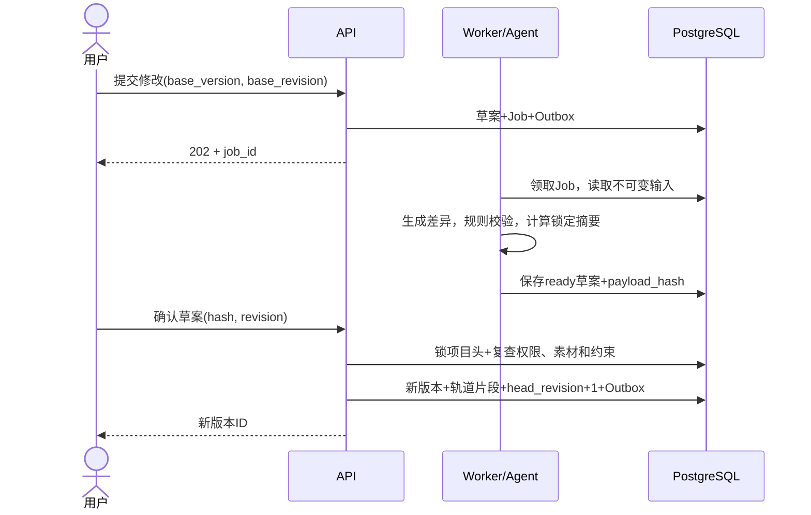

# 影织 AI 系统详细设计文档

| 项目 | 内容 |
| --- | --- |
| 文档编号 | SWAI-SDD-R02 |
| 编制日期 | 2026-11-11 |
| 对应需求 | YINGZHI-AI-V1.1.0-20261110-FULL-R01 / SRS-R01 |
| 设计范围 | Flutter、Web、API、Worker、AI、媒体、存储与部署 |
| 文档状态 | 第二版完整设计；第一阶段子集已实现，本机验证与未验证项见阶段报告 |
| 配套文档 | [数据库设计](database-design.md)、[Agent 设计](agent-design.md) |

## 1. 目标、范围与设计原则

本设计将需求中的七大模块、七类 Agent、双端和五类场景映射为可分工实施的组件、数据对象和处理流程。首个可运行闭环与完整功能范围分开验收，不能以目录、模拟页面或固定响应证明智能能力已完成。

设计遵循：项目数据可追溯；耗时任务异步；模型只提出受约束的业务建议；确认动作由业务服务执行；已有版本不被失败任务覆盖；缓存与队列不能作为唯一事实来源。

内部首版以单套 PostgreSQL、对象存储、Redis 和少量 Worker 为部署起点。七类 Agent 是职责接口，不要求七个独立模型或微服务。模型型号、依赖版本和容量值须在原型验证后锁定。

### 1.1 由创新假设驱动的设计地图

[创新性分析](../innovation-analysis.md) 定义两项待验证机制；[评测协议](../evaluation.md) 负责证据口径。基础设施为机制提供执行条件。

| 机制 | 输入 → 输出 | 确定性边界 | 主要实现与数据 |
| --- | --- | --- | --- |
| 证据驱动故事覆盖 | 确认意图 + 证据 manifest → 节点覆盖报告 + 缺口处置 | 源区间/证据可追溯；检索未完成不报 missing | 本文第 7 节；stories、EvidenceResolver；storyboards/story_nodes/capture_tasks |
| 约束下局部重规划 | 基准版本 + 修改目标 → 影响报告 + 版本差异 | 锁定摘要、范围外保持、版本并发必须通过 | 本文第 8.3、9 节；drafts、PolicyValidator；edit_drafts/versions/clip_dependencies |
| 协作执行支撑 | 结构化建议 + 用户决定 → 可恢复任务与结果 | Agent 无权直接提交版本或自行解锁 | Agent 设计；workflow_runs/approval_requests/jobs/Outbox |

R02 细化尚未发布的 Schema 1.0；没有已部署接口迁移。本次将混用 UUID 与稳定键的解锁字段统一为 `requested_unlock_clip_keys` / `unlock_clip_keys`。已提交原始需求保持不变。

## 2. 系统组成与代码布局

| 组件 | 建议实现模块 | 责任 |
| --- | --- | --- |
| `apps/web` | projects、assets、intent、director、storyboard、editor、review | Vue 页面、Pinia 状态、HTTP 与事件适配、预览和时间轴交互 |
| `apps/mobile` | capture、reshoots、uploads、projects | Flutter 采集、轻量摄影提示、补拍卡、离线待传与同步 |
| `services/api` | auth、projects、uploads、assets、stories、workflows、drafts、versions、exports | 身份、授权、校验、事务、任务受理、事件订阅 |
| `services/worker` | analysis、planning、render、maintenance | 消费任务、租约与心跳、恢复、结果持久化 |
| `packages/ai` | roles、graphs、providers、tools、evaluation | 七角色、状态图、模型适配、工具权限和评测 |
| `packages/media` | probe、analysis、timeline、render | 媒体解析、代理、确定性规则与渲染执行 |
| `packages/contracts` | schemas、examples、generated | 跨端输入输出、EDL、错误、事件和代码生成契约 |

上述为完整设计中的职责名。第一阶段可导入包为 `sw_api / sw_worker / sw_contracts / sw_ai / sw_media`，由根目录 pyproject.toml 安装；完整模块、生产接口和异步执行器继续分期实现。

部署中拟将队列分为 `analysis`、`planning`、`render`、`maintenance`。模型编排和 CPU/GPU 媒体执行分别控制并发，防止长渲染占满普通接口资源。队列名是部署配置，不进入客户端契约。

## 3. 全局契约

### 3.1 标识、日期与序列化

- 业务主键采用服务端生成的随机 UUID，API 为 UUID 字符串，数据库为 `uuid`。文件哈希不承担访问控制或对象主键职责。
- 业务时间使用 UTC `timestamptz`，API 使用含 `Z` 的 ISO 8601；界面按用户时区显示。拍摄时间与入库时间分别存储；无拍摄元数据时留空，不用上传时间替代。
- 媒体和时间轴统一使用整数毫秒，区间为 `[in_ms, out_ms)`，时长为 `out_ms - in_ms`。禁止浮点秒参与业务比较。帧号仅在渲染适配层按有理帧率换算。
- `schema_version` 首版为 `1.0`；方案版本、Schema 版本和代码发布版本独立。
- JSON 字段使用 `snake_case`，所有时长携带 `_ms` 后缀；字节数以 `_bytes` 结尾。金额以数据库 `numeric` 和 API 十进制字符串表达。
- 分页使用稳定游标，如 `(created_at,id)`；默认 20 条、上限 100 条是初始接口设计值，可配置但不得静默改变排序。

### 3.2 权限和身份

首版设计采用邮箱与密码登录；密码仅存 Argon2id 哈希。访问令牌短期有效，刷新令牌使用随机不透明值、数据库存摘要，支持轮换和撤销。建议访问令牌 15 分钟、刷新会话 7 天，正式实现前验证客户端生命周期与密钥管理。

Web 访问令牌保存在内存，刷新令牌使用 HttpOnly、Secure、SameSite Cookie，刷新和退出验证 Origin 并采取 CSRF 防护。移动端刷新令牌使用系统安全存储。WebSocket 由鉴权接口签发一次性短期连接票据，禁止把长期令牌拼入 URL。接口开发时补充登录限流与令牌复用检测。

| 项目角色 | 可读 | 可写与执行 |
| --- | --- | --- |
| owner | 全项目 | 管理成员、归档/删除、编辑、确认、导出 |
| editor | 全项目 | 上传、编辑、任务、确认草案与导出；不能管理成员或删除项目 |
| viewer | 全项目 | 只读预览与进度；不得提交任务、确认或修改 |

每次通过项目资源操作都重新验证成员资格。owner 由 `projects.owner_id` 唯一表示，成员表只存 editor/viewer。资源签名 URL 短期有效，不能替代项目鉴权。跨项目访问返回 404，已授权用户权限不足返回 403。

### 3.3 错误、幂等与并发

错误结构：

```json
{
  "error": {
    "code": "VERSION_CONFLICT",
    "message": "项目版本已变化，请重新生成修改草案",
    "details": {"expected_revision": 3, "actual_revision": 4},
    "retryable": false
  },
  "request_id": "req-example"
}
```

| HTTP | 业务错误 | 处理 |
| --- | --- | --- |
| 400 / 422 | INVALID_ARGUMENT / INVALID_TIMELINE | 展示字段或片段位置，修正后再提交 |
| 401 / 403 / 404 | UNAUTHENTICATED / FORBIDDEN / NOT_FOUND | 重新登录、权限提示或资源不存在 |
| 409 | VERSION_CONFLICT / IDEMPOTENCY_CONFLICT / RESOURCE_IN_USE | 更新基准或按提示处理依赖 |
| 410 | APPROVAL_EXPIRED / DRAFT_EXPIRED | 重新生成，不自动认可旧草案 |
| 413 / 415 | FILE_TOO_LARGE / UNSUPPORTED_MEDIA | 展示实际配置的文件限制 |
| 429 | RATE_LIMITED / BUDGET_EXCEEDED | 有限退避或等待用户调整预算 |
| 503 | DEPENDENCY_UNAVAILABLE | 保留已有状态，返回可重试信息 |

有副作用的 POST 接受 `Idempotency-Key`，按用户、项目（若适用）、操作和键去重。规范化请求哈希一致时返回同一业务资源，不一致返回 409。并发请求不重复产生任务；幂等记录与资源创建同事务提交。客户端在网络重试时复用键。

项目维护元数据 `revision` 和作品头 `head_revision`；前者保护名称、状态与成员变更，后者保护作品版本提交。草案记住 `base_version_id` 与 `base_revision`。确认时比较并交换项目头。单凭客户端最后读取的版本 ID 不足以识别“修改后又回退”的并发变化。

## 4. 客户端详细设计

### 4.1 Web 页面与状态

| 路由设计 | 页面状态与行为 | 主要数据 |
| --- | --- | --- |
| `/projects` | 列表、创建、归档、访问失败 | Project、当前版本、待办数 |
| `/projects/:id/assets` | 上传队列、分析状态、检索、原片定位、纠错 | Asset、Segment、AnalysisRun |
| `/projects/:id/intent` | 原文/语音、参数、约束冲突、确认意图 | Intent revision、未解决项 |
| `/projects/:id/director` | 阶段、角色、依赖、决策摘要、等待确认 | WorkflowRun、Job、AgentRun |
| `/projects/:id/storyboard` | 节点顺序、覆盖、候选证据、补拍与确认 | Storyboard、Node、Candidate |
| `/projects/:id/editor` | 素材左栏、预览中心、AI 右栏、下方轨道 | Version、EditDraft、EDL |
| `/projects/:id/review` | 问题定位、建议采纳、版本差异、恢复 | ReviewReport、Issue、Version |

Pinia 按项目、上传、任务、编辑会话拆分；服务端确认数据和本地未提交操作分别保存。页面切换不清除后台上传队列。版本变化后提示刷新或重新基线化，不把远端新状态覆盖到用户未保存的编辑内容。

时间轴拖动、字幕编辑与自然语言修改最终都转换成 EditDraft；本地预览是临时态，点击保存后通过同一校验与确认路径产生版本。播放器回传时间用于界面定位，不作为素材时间精度来源。

每个页面具备加载、空数据、失败、无权限和离线状态。进度有可测比例时才显示百分比，否则显示阶段。固定样例和预生成结果明确标注。

### 4.2 Flutter 采集与摄影提示

采集链路：权限检查 → Camera 会话 → 本地保存 → 文件摘要 → 上传队列。摄像头被占用、权限拒绝、低存储和应用进入后台时释放或暂停资源，并保留已经保存的文件。

本地轻量提示按受控采样频率计算亮度、模糊、主体位置与稳定性。初始建议采样上限 2 帧/秒、只保留最新待分析帧，属于待真机调优值；不把每一帧上传或写数据库。语义摄影建议可由云端异步返回，单独标记延迟和不确定性。NFR-PERF-001 的 500 ms 目标只统计本地分析。

本地上传记录至少含本地文件标识、project_id、capture_task_id、session_id、分片进度、重试原因和修改时间。恢复时先查询服务端会话与分片，避免仅凭本地进度重复完成。设备文件被删除时标记待重新选择。

补拍卡展示“拍什么、为什么、如何拍、建议时长、关联节点”。用户可以无法补拍并选择替代路径；拍摄上传只是提交证据，服务端重新分析后才判断节点是否覆盖。

## 5. API 目录与输入输出

统一前缀 `/api/v1`。下表是拟实施路由，尚不可调用。GET 默认 200；创建同步资源 201；长任务受理 202；删除或无响应动作 204。所有项目资源位于 `/projects/{project_id}` 作用域，服务端不得只凭子对象 ID 越过授权。

| 方法与路径（省略 `/api/v1`） | 输入要点 | 输出/行为 |
| --- | --- | --- |
| POST `/auth/register`、`/auth/login` | email、password | 用户/访问令牌，建立刷新会话 |
| POST `/auth/refresh`、`/auth/logout` | Cookie 或移动端刷新凭据 | 轮换/撤销会话 |
| GET/POST `/projects` | 游标；name、scenario | 项目列表/新项目 |
| GET/PATCH/DELETE `/projects/{p}` | if_revision；name、状态 | 项目详情/修改/软删除；DELETE 仅 owner |
| GET `/projects/{p}/members`；GET/PUT/DELETE `/projects/{p}/members/{user_id}` | role（写入时） | owner 管理成员；GET 单成员 |
| GET/POST `/projects/{p}/upload-sessions` | original_name、size_bytes、sha256、capture_task_id | 上传会话；配置的分片大小与过期时间 |
| POST `/projects/{p}/upload-sessions/{s}/parts/{part_no}/sign` | part_size_bytes | 当前分片的短期签名地址 |
| POST `/projects/{p}/upload-sessions/{s}/complete` | 有序 part_no、etag、校验信息 | 完成任务 ID，异步校验后生成 Asset |
| POST `/projects/{p}/upload-sessions/{s}/abort` | reason | 中止未完成会话并安排暂存清理 |
| GET `/projects/{p}/upload-sessions/{s}` | 无 | 分片列表、状态、asset_id 或错误 |
| GET/DELETE `/projects/{p}/assets/{a}` | 删除理由；可选替代引用 | 元数据/删除处理，受引用时返回影响 |
| GET `/projects/{p}/assets` | 游标、状态、类型 | 素材列表 |
| POST `/projects/{p}/assets/{a}/analysis-runs` | profile、config_revision | 分析 Job；不等待结果 |
| POST `/projects/{p}/search` | query、filters、embedding_space_id | 区间、来源、置信度与检索方式 |
| POST `/projects/{p}/segments/{s}/annotations` | supersedes_id、kind、payload | 新纠错记录，原模型结果保留 |
| POST `/projects/{p}/intents` | 原文、target_duration_ms、constraints | 意图草案，revision |
| POST `/projects/{p}/intents/{i}/confirm` | revision、明确参数 | 确认快照，之后不就地修改 |
| POST `/projects/{p}/workflows` | kind、intent_id、base_version_id、预算 | WorkflowRun 与根 Job |
| GET `/projects/{p}/jobs/{j}` | 可选 after_seq | 状态、阶段、错误、事件游标 |
| POST `/projects/{p}/jobs/{j}/cancel`、`/retry` | reason；失败策略 | 取消请求；失败作业的新 Job，关联 retry_of_id |
| GET `/projects/{p}/workflows/{w}` | 无 | 角色任务、产物和待确认事项 |
| POST `/projects/{p}/approvals/{a}/decide` | decision、payload_hash、base_revision | 单次确认结果；恢复工作流事件 |
| GET `/projects/{p}/storyboards/{b}` | 无 | 节点、候选和覆盖依据 |
| POST `/projects/{p}/storyboards`、`/{b}/confirm` | 来源/节点草案；revision | 新草案/确认快照 |
| POST `/projects/{p}/capture-guidance` | 受限帧引用、场景摘要、capture_task_id | 云端摄影建议 Job；端侧分析不走此接口 |
| GET/POST `/projects/{p}/capture-tasks` | 筛选；节点、要求 | 拍摄与补拍卡 |
| PATCH `/projects/{p}/capture-tasks/{t}` | if_revision、choice、reason | 用户领取/无法补拍/重新打开等明确操作 |
| POST `/projects/{p}/edit-drafts` | base_version_id、base_revision、target、operations | 手工草案，或异步 AI 草案 Job |
| GET `/projects/{p}/edit-drafts/{d}` | 无 | 候选 EDL、差异、影响与校验报告 |
| POST `/projects/{p}/edit-drafts/{d}/confirm` | payload_hash、base_revision、unlock_clip_keys | 不可变 Version 与新 head_revision |
| GET `/projects/{p}/versions`、`/{v}` | 游标/版本 | 历史/完整快照 |
| POST `/projects/{p}/versions/restore` | target_version_id、base_revision | 创建复制目标内容的新版本，保留历史链 |
| POST `/projects/{p}/versions/compare` | left_version_id、right_version_id | 镜头、字幕、声音及约束差异 |
| POST `/projects/{p}/versions/{v}/reviews` | 检查范围、profile | 审片 Job |
| GET `/projects/{p}/versions/{v}/reviews` | 游标 | 报告、问题位置与状态 |
| PATCH `/projects/{p}/review-issues/{i}` | disposition、reason | 采纳/忽略/已验证修复等用户处置 |
| POST `/projects/{p}/versions/{v}/exports` | purpose、preset、编码参数 | Export 与渲染 Job |
| GET `/projects/{p}/exports/{e}` | 无 | 阶段、结果对象、过期的下载地址可重签 |
| GET `/projects/{p}/events` | after_project_seq、limit | 持久化事件补拉或游标过期提示 |
| POST `/projects/{p}/events/ticket` | 客户端 last_project_seq | 一次性 WebSocket 票据 |
| WS `/projects/{p}/events` | ticket、last_project_seq | 事件通知，缺口时补拉查询 |

`GET /health/live` 与 `/health/ready` 计划用于部署探测；后者检查必要依赖可用性但不触发模型调用。批量删除、成员邀请邮件、外部视频编辑器格式等不在首版接口扩展中预先实现。

### 5.1 创建异步任务示例

```json
{
  "workflow_id": "00000000-0000-4000-8000-000000000010",
  "job_id": "00000000-0000-4000-8000-000000000011",
  "state": "queued",
  "status_url": "/api/v1/projects/00000000-0000-4000-8000-000000000001/jobs/00000000-0000-4000-8000-000000000011"
}
```

任务通知包含 `event_id`、`job_id`、`seq`、`type`、`state`、`stage`、`occurred_at` 与摘要；每个 Job 的 seq 单调递增，project 事件游标使用持久化的 project_seq，与单 Job 的 seq 分开。projects.event_seq 在项目行锁下递增，与 Outbox 同事务提交；重连按 project_seq 补拉，去重并查询最新状态。游标早于已保留窗口时返回 EVENT_CURSOR_EXPIRED，客户端进行全量状态重同步。

## 6. 素材上传、分析与检索

### 6.1 上传与存储

1. API 鉴权后建立上传会话。分片大小、总大小和类型限制由配置返回，不能只在客户端校验。
2. 客户端通过短期签名地址上传到项目隔离的暂存对象；存储对象键由服务端生成，不使用未经处理的原文件名。
3. 完成请求写入 `completing` 并派发合并/校验 Job，重复调用返回同一任务。
4. Worker 确认服务端对象大小与 SHA-256，探测真实格式及可解码性；不能把 multipart ETag 当作完整 SHA-256。
5. 校验成功后原子关联 StoredObject、Asset 和后续分析事件；会话进入 `completed`。失败进入 `failed`，保留原因，暂存对象按策略回收。
6. 仅在同一项目内按实际原片哈希去重；新提交的补拍关系仍需关联 capture_task_id，不因文件去重丢失业务记录。

分片记录与对象存储之间采用可重入校验与对账。对象已完成但 DB 未提交时，重试通过同一上传操作标识查找对象，不重新覆盖其他用户文件。

### 6.2 分析流水线

探测 → 代理/缩略图 → 切镜/关键帧 → 转写/OCR → 标签、事件与质量 → 向量索引 → 发布结果。阶段按依赖拆成 Job，能独立缓存与重试。无音轨时转写为 not_applicable 的阶段结果，不能误报整次分析失败。

AnalysisRun 固定媒体哈希、配置摘要、模型版本与产物；新分析生成新 run 和 segment，成功后再切换 `assets.active_analysis_id`。切换前旧索引继续有效；失败不能混入半成品。已有版本引用旧 segment 时继续可追溯。

照片作为静态素材保存，分析 segment 的 `in_ms/out_ms` 均为 NULL；显示时长由时间轴决定。视频/音频 segment 为正时长半开区间。用户纠错采用新 Annotation 覆盖语义，不删除原模型结果。

### 6.3 检索

服务端首先应用项目授权、未删除素材与 active_analysis_id 过滤，再进行关键词、条件和同一向量空间内的检索。返回 asset_id、segment_id、原片区间、摘要、证据与分数来源；缺少地点/人物确认时不得伪造过滤结果。

文本向量与图文对齐向量使用不同 `embedding_space_id`；维度相同也不能直接混搜。首版小样本优先精确检索，验证召回后再使用索引。候选不足时回退关键词或扩大受限检索，并在响应说明策略。

## 7. 证据驱动的故事覆盖与补拍闭环

### 7.1 叙事约束图与输入快照

输入为已确认 Intent、固定 evidence manifest、有效人工标注及政策配置。manifest 记录素材哈希、analysis_run_id、标注修订、不可变产物引用与摘要；规划过程中不能悄悄换成新分析。故事板 `planning_context` 固定 manifest 引用、覆盖规则版本、候选排序配置和用户确认的顺序边。

节点包含稳定 node_key、表达目的、required、预算，以及 `requirements` 中的事实要求、镜头质量、期望时长范围和软偏好。只把用户明确要求的事件作为覆盖要求，生成的叙事想法不得自动变成真实事件。顺序图必须无环，因果和呼应关系先作为解释性关系；只有用户确认并能表达为可校验约束的关系进入求解器。

### 7.2 候选与证据充分性

先检索，再核对片段合法性与事实要求，最后排序。候选分为 `eligible / rejected / needs_confirmation`；分数不承担合法性和真实性判定。检索分数或模型自报 confidence 不能解释为事实概率。

初版拟采用 `rank = w_semantic * semantic + w_quality * quality + w_speech * speech - w_duplicate * duplicate_penalty`。各分项归一化方法、缺失处理和权重只在开发集确定并固定；未知语音一致性保留 unknown，不能默认为满分。排序只用于满足硬要求的候选之间挑选，不把“相似但无证据”排成已覆盖。

每项事实要求记录 `supported / contradicted / unknown`、证据引用、核对来源（规则/模型/人工）和理由。规则能校验区间、清晰度阈值和时长，不能证明人物身份或复杂事件；语义支持由带引用的模型判断或人工确认给出，保留错误评估。证据引用不存在、超出源区间、属于他项目或不在 manifest 中，确定性拒绝。

### 7.3 覆盖状态判定顺序

| 条件（按顺序判定） | coverage | reason_code / 动作 |
| --- | --- | --- |
| manifest 不完整、分析/检索失败、预算截断或事实归属无法确认 | uncertain | analysis_incomplete / search_incomplete / semantic_unverified；补检索或人工核对 |
| 有合法、质量合格、事实要求受支持且满足节点时间预算的非重复候选组合 | covered | evidence_sufficient；保留候选、组合和依据 |
| 有相关证据，但合格时长不足、画质/音频不可用或组合不能满足硬要求 | insufficient | duration_shortfall / unusable_quality / constraint_conflict |
| 对完整限定搜索范围检查后，没有支持该节点的证据 | missing | no_supporting_evidence；展示已查范围及限制 |

covered 仅指当前 manifest 对当前节点要求的支持，不是全知事实结论。多个源区间有重叠时合格时长按源区间并集计算；同一采访重复三次不能当作三份独立覆盖。节点级结果还需通过跨节点素材复用、总时长和顺序检查；节点各自 covered 不保证全片可行。全局冲突写入故事板校验报告，不改写成缺少拍摄事实。

`resolution` 独立于 coverage。用户 skipped、接受低质量或调整时长均记录显式决定；略过不会把 missing 改成 covered。已确认故事板不可改，补拍与纠错创建下一修订；只有确认后的新修订供后续作品版本引用。

### 7.4 缺口分类与可执行行动

先做可行性门，再做排序：用户能否再次到场、事件是否仍可发生、设备/时间/授权是否具备。无法确认条件则询问或待确认；已结束事件不可建议重演后冒充原始记录。普通摄影任务可以不关联故事节点，补拍必须关联原节点与稳定 node_key。

| 缺口 | 默认处置候选 | 验证方式 |
| --- | --- | --- |
| 无支持素材 | 补拍、已有授权照片/音频、改写结构、用户略过 | 新素材实际支持节点要求 |
| 质量/时长不足 | 重拍、裁剪其他区间、缩短节点、照片替代 | 合格区间与时长重新检查 |
| 语义未知 | 定向检索/采样、原片定位、用户核对 | 新证据或有来源的人工标注 |
| 全局约束冲突 | 等长替换、压缩未锁片段、调整时长、明确解锁 | 完整规则检查；不直接发补拍任务 |

在通过可行性门的任务间，初版用稳定字典序排序：用户指定优先级、必需节点优先、缺口严重度、预计新增覆盖时长降序、预计行动成本升序、node_key。无法估算的成本保留 unknown，不当作零；同级 unknown 排在已知可执行任务后并请求确认。此为待验证启发式，不声称最优。与“故事顺序”“只按缺口严重度”排序对照，检验是否减少无效补拍。

补拍卡保存触发 coverage_report、目标节点、拍摄动作/原因、建议源时长、输出使用时长、地点/时机条件、可替代方案和无法执行入口。建议拍 8 秒供最终 6 秒使用是示例预算，不是固定通用参数。

### 7.5 回传验证和终态

上传只使 capture_task 进入 submitted。分析成功后创建验证 Job，绑定 task_id、task revision、原故事板修订与新 manifest；重新计算相关节点并生成 verification_report。成功判据为目标要求获得合格支持且节点/全局约束可行，用户选择替代则按确认后的新节点要求验证。

写回时检查 Job 租约、任务修订和项目权限；迟到结果记录但不覆盖用户更新。fulfilled 必须引用新故事板修订和验证报告，新素材与原缺口之间可追溯。补拍仍不合格则保留 submitted 和验证失败原因，允许重交或 unable；不以“上传成功”统计补拍成功。重复文件仍保留任务关系，但没有新有效覆盖就没有覆盖提升。

### 7.6 最小可证伪样例

确认的校园故事含开场、过程、采访、收尾四节点，收尾要求只是活动结束的可确认画面。已有素材仅支持前三个；检索完整但没有收尾，报告 missing。系统不能从“校园空镜”推断“散场”；用户核对或采集真实散场镜头后，生成新分析与节点覆盖报告。提交了仍模糊的素材，预期不足而非 fulfilled；活动结束无法补拍，允许新故事修订选择照片替代或略过并保留原因。

## 8. EDL 与时间轴规则

### 8.1 快照结构

EDL 是版本内容的规范化序列化，不是数据库之外另一份可独立修改的事实源。保存版本时在一个事务内写入关系轨道/片段和规范化摘要，按确定排序导出 EDL；读取时可校验摘要一致性。

```json
{
  "schema_version": "1.0",
  "duration_ms": 5000,
  "output": {"width": 1920, "height": 1080, "fps_num": 25, "fps_den": 1},
  "tracks": [{
    "track_key": "video-main", "kind": "video", "position": 0,
    "clips": [{
      "clip_key": "opening-01", "kind": "video",
      "asset_id": "00000000-0000-4000-8000-000000000101",
      "segment_id": "00000000-0000-4000-8000-000000000102",
      "src_in_ms": 1000, "src_out_ms": 6000,
      "dst_in_ms": 0, "dst_out_ms": 5000,
      "speed_num": 1, "speed_den": 1,
      "locked": false, "config": {}, "dependencies": []
    }]
  }]
}
```

示例只有视频轨；字幕、旁白、音乐、环境音在不同轨道。稳定的 track_key/clip_key 跨版本保留，数据库行 ID 每个版本重新创建。

### 8.2 媒体与轨道约束

- 轨道 kind：`video`、`subtitle`、`voiceover`、`music`、`ambience`。片段 kind：`video`、`image`、`audio`、`subtitle`；兼容矩阵在数据库文档定义。
- video/audio 必须引用 Asset，源范围在原片与已引用 Segment 内。image 引用图片 Asset，src 为 NULL。subtitle 文本存 config，asset/segment/src 为 NULL。
- 目标区间总在 `[0,duration_ms]` 内。普通视频/音频遵循 `src_duration * speed_den / speed_num = dst_duration`，首版只允许正向速率，误差按明确帧舍入容差验证。
- 同一视频轨片段默认不得重叠；显式转场允许相邻片段重叠，重叠长度必须与 config 指定长度相等，且不越过源片段可用范围。字幕按层处理，声音轨混音允许重叠。
- 字幕的相对位置、依赖音频和锚定片段变化需纳入依赖传播；删除一个片段不能留下悬空依赖。
- 输出参数只能来自允许的预设与白名单，路径、滤镜和执行命令不由模型直接指定。

### 8.3 锁定保护、依赖图与影响闭包

首版 `locked=true` 冻结整片段：clip_key、track_key、故事节点引用、源对象/入出点、目标区间、速率、config 和依赖。规范化时排除数据库行 ID、version_id 和时间戳；保留所有影响媒体内容和位置的字段。相同 clip_key 在新版本必须存在且规范化摘要相同。删除、移动、改变依赖或以新键替换后删除旧键均算违规。

依赖边在存储中采用 **“dependent 依赖 prerequisite”**；影响传播遍历 prerequisite → dependent 的反向索引。例如字幕依赖采访音频、转场依赖相邻两个画面。`clip_dependencies` 存静态媒体边，重叠、顺延、节点预算和全局时长是求解时计算的约束边。依赖本身不意味着共享项目的所有片段均应重算。

规划前区分三个集合：`requested_target_keys`（用户授权目标）、`predicted_affected_keys`（算法预报的影响范围）、`actual_changed_keys`（基准与候选规范化 diff）。新增键也必须进入实际变化集合，删除键仍按旧键比较；集合使用稳定键而非跨版本变化的 UUID。

```text
input: immutable base, normalized operation, confirmed constraints
I := explicit target clip/node members
repeat until no new members:
    add dependents of I (subtitle, voiceover, transition, audio anchors)
    simulate durations/positions under requested operation
    add clips whose interval/overlap/ripple/node budget must change
    add global-budget participants only if global constraint is violated
    record each added key, causal edge and reason
if fixed point exceeds configured work budget: require broader scope decision
if any changed locked key: return conflict and alternatives, not ready draft
plan within allowed scope, then independently diff/validate the whole candidate
```

图有限且只增加节点，因此闭包最多加入图中全部片段；实际运行设置节点数/用时预算，超限返回 full_replan_required 和原因，不截断后冒称局部正确。全局音乐、总时长或速度变化可以扩大至全片；此时不承诺局部性能优势。先形成预报，再求解；求解扩大范围则更新报告并重新提示，不事后把所有实际变化追认为已授权。

可在预报阶段由服务端预分配新增片段稳定键；新增键也须列入授权，模型不能事后另造键绕过范围比较。

`impact_report` 包含目标集合、预报集合、每条传播原因、锁定冲突、全局扩展原因、基准摘要和规则版本。`diff` 独立计算实际变化及 added/removed/updated 字段。ready 前满足：无硬错误、实际变化属于预报集合、预报中的新增范围已经用户授权、所有未解锁锁定项摘要相同。界面显示目标、连带变化、范围外保持和冲突；不能只给模型一句“其余未变”。

如果触及锁定内容，允许优先等长替换、压缩未锁片段或缩小目标；用户明确选择解锁时先生成新草案。ready 草案列明 `requested_unlock_clip_keys`，确认请求的 `unlock_clip_keys` 必须与其一致且受 payload_hash 保护。普通确认不得隐式解锁。

**算例**：开场 [0,6000)、采访 [6000,18000)、过程 [18000,54000)、结尾 [54000,60000)，采访和结尾锁定。替换 6 秒开场应只改开场及其字幕/转场；拟改成 8 秒又整体顺延会移动锁定采访，必须拒绝。若把开场位置保持 6 秒并选另一源区间，则可生成合法草案。局部重规划不等于局部 MP4 编码；完整输出可以继续全片渲染，计时分开。

## 9. 修改、确认与版本事务



版本内容提交和导出发布分开。确认可以保存一个尚无预览文件的合法版本；预览/导出成功后另行增加 Export 记录，不改版本内容。任务失败只改变任务与产物状态，不清除当前版本或历史已成功导出。

确认时重新读取项目、草案和素材状态，防止生成后素材被删除或用户失去权限。`payload_hash` 必须匹配用户看见的草案。两用户确认不同草案时只允许匹配当前 revision 的事务成功，另一方返回 409。

恢复历史版本采用“复制目标内容形成新 Version，parent 指向恢复前当前版本，restored_from 指向目标版本”；head_revision 递增。若历史素材已被删除且不可用，恢复被阻止并列出缺失项，不自动声称可重新渲染。

## 10. 审片、预览和导出

审片分两路：规则检查确定性错误；模型检查叙事、重复和主观建议。问题记录 severity、category、location、evidence、confidence、suggestion 和 disposition。缺乏可靠检测条件时标记待复核，不把“未发现”作为合格证明。

输出分 `purpose=preview|final`，绑定精确 version_id、content_hash、preset_hash 和渲染配置。预览和正式导出可分辨率不同，但使用同一时间轴；界面清楚标记代理质量与真实成片。

导出步骤：鉴权 → 验证引用与规则 → 去重受理 → 规范化输入 → 分段/整段处理 → 封装 → 解码抽检、参数与时长检查 → 上传临时对象 → 对象 HEAD/校验 → 事务标记对象 available 与 Export succeeded。下载地址按需签发。

复用分段缓存按媒体哈希、源范围、变换、工具版本和参数计算，不只按素材 ID。局部重规划不承诺 MP4 只渲染局部；分别记录规划、片段处理和封装/编码时间。

## 11. 长任务与一致性

Job 状态统一为 `queued/running/waiting_user/succeeded/failed/cancelled`。waiting_user 释放 Worker 执行资源，通过持久化 approval 再恢复，不让进程长时间阻塞等待。

API 在同一事务写业务变化、Job 与 outbox_events；派发器至少一次发布，消费者按 Job/幂等键和执行租约去重。业务任务状态以 PostgreSQL 为准，Celery 结果后端只用于调度辅助。

Worker 以 `lease_token` 和 `lease_expires_at` 领取执行，心跳续租；完成写入必须匹配 lease_token。租约过期后回收器检查可恢复产物，重新排队或明确失败；旧 Worker 的迟到提交被拒绝。外部调用仍可能发生多次，不能宣称端到端 exactly-once。

取消通过 cancel_requested_at 请求，Worker 在阶段边界和受控子进程中检查。渲染终止后清理暂存，不删除已发布产物。用户重试失败 Job 创建新 Job 并关联 retry_of_id；基础设施重投递仍属于原 Job 的 attempt。

## 12. 安全、删除与隐私

上传按大小、格式、解码与资源限制检查，服务端生成路径，媒体子进程使用参数数组、限制时长和临时目录。模型输入中的素材文字和转写是数据，工具只接受结构化参数并再次鉴权。

用户可先查询删除影响。素材无版本引用时可标记删除并异步回收；被不可变版本引用时默认返回 RESOURCE_IN_USE。owner 如明确选择强制删除，保留元数据墓碑及引用，停止未来检索/渲染，将相关版本呈现为素材缺失；既有导出按明确的项目删除/保留政策处理，不静默丢失。

数据库和对象存储之间无跨系统事务。使用删除标记、延迟回收和对账，不在单次 API 中先删原片再提交 DB。项目删除先撤销访问并取消任务，再按引用与保留期清理；数据保留期是部署前待确认事项。

## 13. 可观测性与性能

日志统一包含 request_id、project_id、workflow_id、job_id、agent_run_id、version_id、step、attempt、duration_ms、error_code。决策保存可读摘要与来源，不要求保存模型隐藏推理。日志和错误响应不包含密钥、完整个人转写或签名 URL。

指标拆分上传、排队、分析、规划、waiting_user、渲染和下载。P95 需要样本量和硬件，不用单次演示替代统计。需求目标保持原值：本地摄影分析 500 ms、故事规划 180 s、局部规划 20 s、导出 180 s、可测音画偏移 100 ms；这些均未实测。

首轮负载采用 30 段、约 10 分钟输入、120 秒 1080p 输出，记录队列负载、格式、编码、模型位置与网络。优先识别等待和重复工作，再决定缓存、并发或索引调整。

## 14. 部署、配置与实现顺序

开发环境拟用 Compose 提供 PostgreSQL/pgvector、Redis 和 S3 兼容存储；API、Worker 可本机或容器运行。数据库迁移作为独立步骤先执行，再启动消费者。服务启动检查 schema 兼容性，失败时不得继续处理旧格式任务。

已有 `.env.example` 只是配置草案。实际初始化时增加鉴权密钥引用、允许源、上传上限、超时、队列并发、模型预算、对象保留和检查点配置，同时更新环境文档；密钥不写 model_profiles。

实施批次改为：核心契约/纯函数样例 + 最小身份与项目 → 上传与证据 manifest → 覆盖/补拍验证 → 合法 EDL/局部影响/版本 → 七角色门控与可靠恢复 → 双端摄影、多轨审片与五场景扩展 → 冻结对照与交付。双端、队列和媒体探针从第一批并行验证；生产持久化、租约和权限须在真实闭环发布前补齐。具体窗口与资源风险见 [路线图](../roadmap.md)，不能把此顺序视为 60 日可行性已经得到证明。

## 15. 需求追踪与验收用例

| 范围 | 需求 | 主要设计 | 验收要点 |
| --- | --- | --- | --- |
| 双端与项目 | FR-SYS-001—008 | 3、4、5、11 节 | 双端同项目，角色隔离，断线重连 |
| 摄影 | FR-CAM-001—008 | 4.2、7 节 | 真机提示，权限拒绝，补拍回传 |
| 素材 | FR-MAT-001—010 | 6、12 节 | 校验去重、区间检索、再分析与删除影响 |
| 意图 | FR-IDEA-001—005 | 7 节 | 冲突可见，确认快照，任务绑定版本 |
| Agent | FR-AGT-001—008 | 7、11 节及 Agent 文档 | 七角色有实际输入输出，人工暂停与恢复 |
| 故事 | FR-STO-001—009 | 7 节 | 四类覆盖，补拍/替代/略过，新增素材更新 |
| 剪辑 | FR-EDT-001—011 | 8、9、10 节 | 非法范围拒绝、锁定、差异、声音依赖和导出 |
| 审片 | FR-REV-001—010 | 9、10 节 | 问题可定位，版本对比与历史恢复 |
| 非功能 | NFR-*（含 NFR-COMP-001—002） | 11—14 节 | 中断、重复、权限、备份和真实计时 |

具体需求编号沿用 [需求基线](../requirements.md)，不能新造编号代替原文。跨组件必测场景：

1. 重复完成上传、重复确认与重复导出，均只产生一个对应业务资源。
2. 新分析失败，旧分析仍可检索；成功切换后新搜索不混入旧索引。
3. 两客户端基于同一 revision 修改，后确认者收到 409，已有版本不损坏。
4. 修改开场长度触及锁定结尾，必须提示冲突且不能暗中顺延。
5. Worker 在对象上传后、事务提交前崩溃，恢复不重复发布；租约失效后拒绝旧结果。
6. waiting_user 时重启，用户一次确认只恢复一条工作流分支。
7. 删除在用素材有影响提示，强制删除后检索隐藏且恢复/渲染明确失败。
8. 同维度不同模型向量不混搜，图文能力与文本检索分别报告。

这些是拟验收用例，当前没有执行记录。效果实验、分组和分母统一遵循 [评测与证据协议](../evaluation.md)，不能由各组件各自选择更有利的测试口径。

## 16. 设计决策与待验证项

| 决策 | 本版选择 | 变更门槛 |
| --- | --- | --- |
| 时间与标识 | UUID、UTC、整数毫秒、半开区间 | Schema 变更需迁移和多端同步 |
| 版本 | 不可变快照，恢复生成新版本 | 不允许运行中静默改历史 |
| 队列一致性 | Outbox、至少一次、租约与幂等 | 需中断与重复投递验证 |
| 授权 | owner/editor/viewer、项目域 | 共享模式扩展前补权限矩阵 |
| 检索 | 分向量空间，先精确后索引 | 实测召回、过滤和内存后决策 |
| 鉴权 | 短访问令牌+可撤销轮换刷新会话 | 依赖与跨端会话原型验证 |
| 仍待确定 | 依赖、模型、维度、文件限制、编码预设、设备与保留期 | 在首阶段技术验证记录结果与修订号 |

## 17. 技术依据

2026-11-11 设计核对范围为 PostgreSQL 约束、pgvector、Celery、FastAPI 安全示例及 LangGraph 持久化/中断的官方说明。具体版本不在本设计中推定为“最新”或已安装，实际实现锁定后需重新核验，链接列于 [数据库设计](database-design.md) 和 [Agent 设计](agent-design.md)。

FastAPI 身份验证参考：<https://fastapi.tiangolo.com/tutorial/security/oauth2-jwt/>。其中示例仅提供组件用法，本项目的项目域授权、刷新会话、CSRF 与撤销仍需单独实现和验证。
