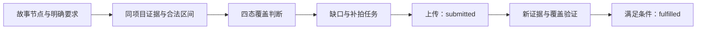

# 第一阶段实施大纲：契约与可验证内核

| 项目 | 内容 |
| --- | --- |
| 文档编号 | SWAI-P1-R02 |
| 编制日期 | 2026-11-11 |
| 计划窗口 | 2026-11-15—2026-11-21，共 7 个日历日 |
| 对应计划 | R02 路线图第一阶段；不改写需求基线的历史排期 |
| 阶段目标 | 建立双端/API 最小骨架、共享契约和可执行规则样例，为两项核心创新提供可验证基础 |
| 当前状态 | 实施计划；本文不作为代码完成或阶段验收通过的证明 |
| 设计依据 | [创新性分析](innovation-analysis.md)、[详细设计 R02](design/detailed-design.md)、[数据库设计 R02](design/database-design.md)、[Agent 设计 R02](design/agent-design.md)、[评测协议](evaluation.md) |

## 阅读摘要

| 要点 | 第一阶段安排 |
| --- | --- |
| 核心交付 | 双端/API 最小工程、统一契约、两组可回放规则样例、基础迁移与复现记录 |
| 创新一 | 故事要求 → 可追溯证据 → 四态覆盖 → 补拍验证；避免检索未完成就判缺失、上传即完成 |
| 创新二 | 修改目标 → 依赖传播 → 预先批准范围 → 候选差异 → 锁定/范围校验；保护用户已确认内容 |
| 执行顺序 | 契约冻结 → 核心规则 → 双端联调 → 独立复核；工程、数据准备和工具探针按依赖并行 |
| 验收方式 | T01—T10 对应 P1-01—11，每项保留输入、实际输出、失败反例与版本摘要 |
| 证据边界 | 固定样例检验规则；真实媒体检验工具链；创新效果由后续对照实验测量 |
| 当前结果 | 2026-11-11 提前工程验证另见[阶段报告](reports/phase-1-report.md)，正式复核仍待执行 |

## 1. 阶段定位与目标

第一阶段要交付一个能启动、能检查、能复现的最小工程：同一项目可被 Web 和 Flutter 读取，核心对象可被机器校验，固定输入能触发正确的覆盖判断、锁定检查和范围检查，失败原因可定位。

本阶段重点验证“创新机制是否具备可实现的规则基础”。完整素材理解、自动补拍、依赖求解和七角色编排分别在后续阶段集成；七模块、七角色、双端和五类场景的总体范围继续保留。

完成后应能回答四个问题：

1. 故事节点引用的证据，能否追溯到同一项目的合法素材区间？
2. 检索未完成、质量不足和确实无支持素材，能否被区别处理？
3. 局部修改是否改变了锁定内容，或超出求解前批准的范围？
4. 规则、数据、代码和结果是否可以由另一名成员复现？

## 2. 创新性如何体现在第一阶段

### 2.1 创新落点与实施证据

| 创新假设 | 解决的问题与重要性 | 第一阶段实施内容 | 本阶段可展示的证据 | 后续验证位置 |
| --- | --- | --- | --- | --- |
| 证据驱动的故事覆盖与补拍闭环 | 防止故事大纲超出已有素材，并让用户知道还缺什么 | Evidence、StoryNode、CoverageReport、CaptureTask 契约；固定事实输入下的四态规则和补拍验证门 | 证据定位；检索失败输出 uncertain；上传事件不能直接使任务 fulfilled | 阶段 2 接真实分析，阶段 3 完成补拍回写；D1/D1b 对照 |
| 依赖感知的局部重规划 | 修改一个镜头时保护其他已确认内容，减少返工 | 稳定 clip_key、依赖边、ImpactReport、EditDraft、Version 契约；最小图传播探针与候选差异校验 | 等长替换开场通过；采访/结尾被改时拒绝；范围扩大必须重新授权 | 阶段 4 完成真实操作解析与依赖求解；D2 对照 |
| 受约束的 Agent 协作 | 使模型建议可检查、可确认并可追溯 | 定义角色输出进入规则层的接口、证据引用和权限边界 | 固定角色输出走与未来模型输出相同的校验入口；不能自行解锁或提交版本 | 阶段 5 接七角色、预算、中断和恢复；D3 对照 |

七个角色、框架选型和数据表数量不单独构成创新证据。第一阶段能证明的是规则和接口在给定样例上可执行；不能由此推出真实素材识别准确率、创作质量或效率已经提升。

### 2.2 建议用于阶段汇报的表述

> 第一阶段围绕“故事有据可依、修改有界可控”建立可执行基础：把素材证据、故事要求、覆盖状态和补拍验证显式关联，把修改目标、依赖影响、锁定条件和版本差异显式关联。系统先校验来源与约束，再允许建议进入确认流程，为后续真实模型和七角色协作提供统一边界。

上述表述是设计主张。阶段报告应另列已运行的样例、实际结果和未完成项，不使用“首创”“行业领先”或未经对照证明的提升百分比。

### 2.3 与拟设简化方案的对比

以下是项目内部拟用于对照的简化方案，用来说明实施取舍，不是对其他产品能力的事实判断。第一阶段使用相同固定输入比较规则行为；真实模型的质量与效率对照沿用[评测协议](evaluation.md)，不能用固定样例替代。

| 对照维度 | 拟设简化方案 | 本项目拟实施的机制 | 为什么重要 | 第一阶段检查方式 |
| --- | --- | --- | --- | --- |
| 故事与素材关联 | 直接生成故事文本，人工检查是否有可用镜头 | 故事节点关联可追溯证据，并输出四态覆盖报告 | 让“有什么、缺什么、还不能判断什么”成为可检查结果，减少无依据的规划进入下一步 | 相同节点分别输入有效、低质量、检索未完成和无支持证据，核对四态及理由 |
| 补拍完成判定 | 上传成功后直接关闭任务 | 上传、分析、覆盖验证分开；新证据通过验证后才 fulfilled | 上传是传输事实，补拍是否满足故事需求需要另行验证 | 只上传不满足完成条件；旧修订和无分析依据的验证被拒绝 |
| 用户局部修改 | 接受候选整体结果，再人工查找连带变化 | 先冻结批准范围，再检查依赖影响、锁定和完整差异 | 保护用户已经确认的内容，使修改边界可预期、可追责 | 同一基准下，合法开场替换通过；锁定内容、范围外变化和换键绕过被拒绝 |
| Agent 建议落地 | 将角色输出直接当作可执行结果 | 角色输出必须引用合法证据并通过业务校验，确认权留在业务服务 | 模型建议具有不确定性，需要独立的执行约束 | 固定角色输出进入统一校验入口，越权解锁或提交请求被拒绝 |

本阶段的差异应体现为可复现的行为：在简化方案会误关闭补拍任务或接受越界候选的位置，规则内核给出明确的拒绝依据。只有实际运行后，才能把相应行为写为已验证结果。

### 2.4 创新的重要性与投入顺序

第一优先级是证据可追溯和四态覆盖：它们决定后续故事规划与补拍依据是否可信，必须先于真实模型接入建立。第二优先级是锁定、范围和草案摘要校验：它们决定局部修改能否保护已有成果，必须先于自动提交版本建立。两项机制都属于 P0，不因优先顺序而降低任何一项的验收要求。

Agent 协作是这两项机制的执行支撑。第一阶段先固定其证据和权限接口；七角色完整编排、创作效果与成本收益留到后续验证。基础设施、框架数量和页面数量分别记录工程进度，不代替创新验证。

### 2.5 两条创新实施链路

覆盖判断保留检索完成性与质量条件；补拍验证同时核对任务修订、故事板和分析依据。上传只推进提交状态，新证据验证才决定是否满足节点要求。

发现候选越界或改变锁定内容时返回具体拒绝原因。扩大批准范围需要重新授权；第一阶段确认入口只验证契约，生产版本事务在后续实现。

## 3. 范围与优先级

| 层级 | 本阶段安排 | 完成边界 |
| --- | --- | --- |
| P0：契约与规则 | 共享 Schema、固定样例、覆盖规则子集、依赖探针、锁定/范围校验 | 可执行、可重复，有明确正反例 |
| P0：最小工程 | Web、Flutter、API 骨架，最小身份/项目授权，核心数据持久化与测试入口 | 双端读取同一真实 API；跨项目访问被拒绝 |
| P0：证据与复现 | 素材清单、数据版本、实际运行记录、启动和检查命令 | 另一名成员可以按文档复现；失败保留 |
| P1：技术探针 | 小型授权素材上传、ffprobe/FFmpeg 最小渲染、Flutter 真机采集；模型可达性与成本试调用 | 记录实际配置、结果和限制，模型不作为规则测试依赖 |
| 后续集成 | 完整分析检索、生产级补拍闭环、完整局部求解、七角色工作流、多轨审片 | 沿路线图继续实施；不得记为第一阶段已完成 |

P0 为本阶段验收门槛。P1 应尽早探测高风险依赖，阻塞时登记问题、负责人和复核日期；P1 未完成仍保留到后续追踪。7 日窗口的可行性取决于三名成员实际投入，启动日核定工时；不能把日历天数直接当作全职人日。

## 4. 工作包与计划交付物

### 4.1 WP1：统一契约与机器校验

按 R02 字段字典建立单一契约来源，落实 UUID、UTC、整数毫秒半开区间、snake_case、schema_version，以及必填/可空语义。选择并记录 Schema 与 OpenAPI 生成方式，双端使用同一组有效/无效示例检查映射。

| 对象组 | 第一阶段必须明确的内容 |
| --- | --- |
| Project / Intent / Asset / Segment | 项目作用域、确认意图、素材来源、分析批次、合法源区间；作为核心对象的基础引用 |
| Evidence / EvidenceManifest | asset/segment/区间/分析版本引用、证据类型与来源、清单摘要；区分人工录入和工具分析 |
| StoryNode / CoverageReport | 稳定节点键、用户要求、候选依据、covered / insufficient / uncertain / missing、判定理由与 search_complete |
| CaptureTask | 关联节点、缺口、可行条件、用户处置、提交与验证依据；上传成功与 fulfilled 分离 |
| EDL / Clip / Dependency | 源/目标区间、轨道、稳定 clip_key、锁定条件；clip_key depends_on depends_on_clip_key |
| ImpactReport / EditDraft / Version | 目标/预报/批准/实际变化集合的区分，基准修订、差异、payload_hash、显式解锁键及不可变版本引用 |
| Job / Error / 角色信封 | 状态、错误结构、证据引用、任务与配置追踪；骨架不等于已实现工作流恢复 |

计划产物：`packages/contracts/` 中的 Schema、正反例与校验入口；接口契约及跨端映射说明。对象名与持久化字段以现有设计为准，发现冲突时同步三份设计，不另造一套命名。

### 4.2 WP2：两个创新机制的最小规则内核

| 规则组件 | 第一阶段可执行子集 | 保留到后续的工作 |
| --- | --- | --- |
| EvidenceResolver | 核对项目、素材、分析版本及区间存在性；解析固定证据引用 | 真实关键帧、转写和模型分析接入 |
| CoverageEvaluator | 对已标注输入运行四态规则；search_complete=false 不得输出 missing；重复区间不重复计时长 | 语义支持判断、真实质量阈值校准和全片可行性 |
| GapPlanner 的验证门 | 检查固定任务的节点引用与必要条件；拒绝仅凭上传把任务置为 fulfilled | 自动生成、排序、现场可行性判断和真实回写 |
| ImpactResolver 探针 | 在小型固定 DAG 上验证被依赖者到依赖者的传播、环拒绝和传播原因输出 | 修改语义解析、不同依赖类型传播、全局时长与求解停止策略 |
| PolicyValidator | 规范化 EDL；比较锁定摘要与完整 diff；拒绝范围外变化；解锁键与确认内容一致 | 生产版本确认事务、恢复、并发与媒体执行联动 |

本阶段候选 EDL、语义支持标注和修改目标可由固定样例提供，必须标明来源。预报/批准范围在候选求解前冻结；禁止看完 diff 后再扩大授权范围。新增、删除、换键、移动轨道和修改依赖均属于变化。

### 4.3 WP3：双端/API 与数据最小骨架

- Web：提供项目入口、证据/节点结果列表、修改差异及拒绝原因的最小展示，显示样例来源与当前运行模式。
- Flutter：提供项目读取、补拍卡列表与状态展示骨架；真机采集/回传作为技术探针，实际支持设备另行记录。
- API：提供健康检查、最小身份与项目读取、授权检查，以及样例校验/回放适配入口。新增接口须同步契约与鉴权约定，不将演示入口默认暴露到生产。
- 数据层：先落实身份、项目/成员、素材及分析引用所需的最小迁移，建立同项目约束与可重复初始化方式；其余核心对象先通过契约和受控样例校验，真实业务状态启用前补齐对应迁移。
- Worker：建立任务入口和六态映射骨架；若本阶段启用真实异步任务，应同时落实幂等、Outbox 与有效执行租约；尚未落实时回放按同步方式运行，不宣称已有可靠异步闭环。

数据库按 36 张业务表设计分批迁移，本阶段不要求一次落全表。正式版本确认接口只有在不可变快照、项目头并发、锁定/范围检查和事务设计均通过后才启用；样例回放不能绕过这些条件发布真实版本。

### 4.4 WP4：样例、检查入口与复现记录

固定样例用于检验规则正确性，真实媒体探针用于检验工具链可用性，两者分别记录。建立计划中的 `examples/phase-1/` 样例清单和跨服务验收用例；局部规则测试跟随所属包，避免复制另一套实现。

每次运行记录：数据/Schema/规则版本、输入摘要、代码提交、工具链/设备、运行模式、期望与实际结果、通过/失败、错误及原始工件位置。模型未参与时明确写“未调用模型”，不能填入虚构配置。启动和验证命令在工程初始化后填写真实值，不能将本文目录建议当作已有命令。

### 4.5 可直接拆分的实施任务

以下任务是工作包的执行清单。A/B/C 为职责占位，实际负责人沿用第 6 节启动日安排；“完成条件”必须由代码或运行记录支撑。

| 任务 | 主责 / 协作 | 前置依赖 | 交付内容 | 完成条件与验收编号 |
| --- | --- | --- | --- | --- |
| T01 工程与环境基线 | B / A、C | 无 | 双端/API 初始化、依赖锁定、配置示例、工具与设备清单 | 按实际命令启动 API/Web，构建并运行 Flutter；P1-01 |
| T02 共享契约与映射 | C / A、B | 三人确认字段边界 | Schema 来源、有效/无效示例、双端映射、版本约定 | 三端按同一组输入得到一致映射与校验结论；P1-02 |
| T03 身份、项目与最小迁移 | B / A | T02 中身份/项目契约 | 身份入口、项目授权、素材/分析引用基础表及初始化步骤 | 重启后可读取持久化项目，越权访问被拒绝；P1-01、03 |
| T04 证据解析与四态覆盖 | C / B | T02、样例 A 输入 | 引用/区间检查、时长去重、覆盖结果与理由 | 合法区间通过，非法引用被拒绝，四态及检索未完成用例通过；P1-03—05 |
| T05 补拍验证门 | C / B、A | T04 | 提交与验证状态、修订校验、独立用户处置 | 上传不能直接完成，旧修订/无验证依据被拒绝，略过不改变覆盖事实；P1-06 |
| T06 依赖、锁定与范围校验 | C / B | T02、样例 B 基准 | 固定 DAG 探针、预先批准范围、完整 diff 和策略校验 | 传播方向正确、环被拒绝，锁定与范围外变化均被阻断；P1-07—09 |
| T07 草案确认契约 | B / C | T06 | 基准摘要、完整 payload_hash、显式解锁与确认校验入口 | 内容篡改、基准过期和解锁不匹配被拒绝；只验契约，不发布真实版本；P1-10 |
| T08 双端展示与 API 联调 | A / B、C | T03；T04—07 按完成顺序接入 | 项目、证据/节点、补拍卡、差异与拒绝原因展示 | 双端读取同一真实 API；界面明确固定输入和运行模式；P1-01、02 |
| T09 用例、复现与阶段报告 | 三人 | T01—08；记录从首日开始 | A/B 样例、P1-01—11 结果、工件索引与阶段报告 | 另一名成员可复现输入与实际结果，失败和未验证项完整保留；P1-11 |
| T10 媒体、真机与模型探针 | B / A、C | 工具/设备/授权可用 | 上传/解码/最小渲染、真机采集、模型可达性与调用记录 | 分项记录实际成功或阻塞、责任人和复核日期；对应 P1 技术探针 |

主依赖顺序为：契约冻结 → 证据/编辑规则 → 双端联调 → 复核验收。工程、样例准备、身份数据层和工具探针可按依赖并行推进；真实设备或模型资源不足时先保留探针阻塞记录，规则测试继续使用显式固定输入。

## 5. 两个贯穿实施的固定样例

### 5.1 样例 A：校园活动的故事覆盖与补拍验证门

故事包含“开场环境—活动过程—人物感受—结束告别”四个节点。小型授权素材清单配合人工标注事实，至少包含可用过程镜头、质量不足采访和无告别支持的情况。

演示顺序：

1. 展示节点要求、候选区间与分析来源，合法过程证据产生 covered。
2. 有语义支持但不满足已设质量/时长条件时产生 insufficient。
3. 将检索标记为未完成，缺少候选的告别节点保持 uncertain；完成限定范围检查后，无支持证据才可为 missing。
4. 提交关联告别节点的固定补拍任务，回放上传事件后保持待分析/验证语义；仅在加入新分析与覆盖验证依据后才允许 fulfilled。
5. 用户选择略过告别节点时保留原覆盖事实，单独记录处置，不把 missing 改为 covered。

这些结果来自固定事实输入和规则执行；真实补拍是否有效在阶段 3 验证。

### 5.2 样例 B：只替换开场，保留采访和结尾

建立含开场、锁定采访、锁定结尾及字幕依赖的基准 EDL。用户提出等长替换开场，预先指定目标、依赖图和批准范围；固定候选分别覆盖合法替换、锁定修改及范围外变化。

演示顺序：

1. 探针输出影响预报及传播原因，在生成候选前记录批准范围。
2. 合法等长替换通过检查，展示开场变化及采访/结尾摘要保持情况。
3. 改动采访、删除锁定键后换新键，或移动范围外字幕，均被完整 diff 与策略校验拒绝。
4. 延长开场导致影响超出原范围时返回需重新授权，不自动接受额外变化。
5. 展示 ready 草案内容摘要与显式解锁请求；样例确认不代表生产版本提交链路已完成。

候选由样例提供；本阶段验证传播方向和保护规则，真实自然语言解析及完整求解在阶段 4 实施。

## 6. 七日实施安排与三人分工

沿用路线图的 A/B/C 职责占位；实际成员和有效投入在 11 月 15 日核定。每日结束保留可检查产物，接口冻结后再推进依赖它的联调。

| 日期 | A：Web / Flutter | B：API / 数据 / 媒体 | C：AI / 规则 / 样例 | 当日检查点 |
| --- | --- | --- | --- | --- |
| 11-15 | 双端工具链、最小页面 | API/数据库环境、身份授权方案 | 两个样例与规则清单 | 核定工时、设备与依赖；三人共同确认对象与边界 |
| 11-16 | 契约映射与样例展示壳 | 最小迁移、项目读取与授权 | Schema、正反例、校验入口 | 冻结第一批契约及稳定键语义 |
| 11-17 | 接真实项目 API、显示证据来源 | 同项目引用、区间检查适配 | 覆盖四态子集、补拍验证门 | 样例 A 可回放；跨项目引用被拒绝 |
| 11-18 | 差异列表、锁定状态展示 | EDL 校验适配、基准信息读取 | 固定依赖探针、摘要与范围比较 | 样例 B 正反例可回放 |
| 11-19 | 双端联调、Flutter 真机探针 | 上传/媒体最小探针、失败记录 | 数据来源检查、模型可达性探针 | P0 集成；P1 风险登记 |
| 11-20 | 错误与状态体验、干净环境复现 | 验收入口、授权与配置检查 | 反例回归、证据包整理 | 修复 P0 阻塞，复核性能目标可测性 |
| 11-21 | 联合演示与交接 | 联合演示与交接 | 联合演示与交接 | 按验收清单记录通过/失败，确定阶段 2 输入 |

契约由三人共同维护：C 提出机制字段，B 核对持久化和服务边界，A 核对双端交互与类型映射。P0 出现阻塞时优先修复契约、授权和规则，调整 P1 探针安排并记录影响，不削减总体功能范围。

## 7. 阶段验收清单

以下定义本阶段的验收条件。实际运行状态、证据与未验证项单列于[阶段报告](reports/phase-1-report.md)，本表不直接宣告通过。需求编号表示覆盖其中的基础约束，不代表对应完整功能已经验收。

| 编号 | 验收内容 | 通过条件与证据 | 对应需求/机制 |
| --- | --- | --- | --- |
| P1-01 | 工程可复现 | 另一成员按文档启动 API/Web，并构建运行 Flutter；记录工具版本、设备和命令 | NFR-MNT-001；双端基础 |
| P1-02 | 共享契约 | 同一组有效/无效输入经服务端校验，双端映射结果一致；必填、可空、UUID、区间边界都有用例 | 全局契约 |
| P1-03 | 项目授权 | 两个身份/项目下，越权项目访问与跨项目证据引用均被拒绝，返回受控错误 | 项目级授权 |
| P1-04 | 素材区间 | 负数、零时长、反向、超出原片及错误分析引用被拒绝；合法边界通过 | FR-EDT-011；来源约束 |
| P1-05 | 覆盖四态 | 四态都有固定正例；未完成检索不报 missing；重叠区间不重复累计 | FR-STO-003—005 |
| P1-06 | 补拍验证门 | 上传事件不能直接 fulfilled；验证来源缺失、引用旧修订均被拒绝；略过与覆盖事实分离 | FR-STO-008—009 |
| P1-07 | 依赖方向 | 小型 DAG 沿被依赖者到依赖者传播并保留原因；循环输入被拒绝 | FR-EDT-009—010 的基础 |
| P1-08 | 锁定保护 | 合法替换通过；锁定片段字段变化、删除/换键均被拒绝，基准输入不被修改 | FR-EDT-010；锁定摘要 |
| P1-09 | 范围校验 | 范围外新增/删除/更新/依赖变化被拒绝；范围在候选前确定，扩大需新授权 | FR-EDT-009；影响报告 |
| P1-10 | 草案确认契约 | payload_hash 覆盖基准、候选、影响、差异、校验与解锁；内容改变或解锁键不匹配不能通过 | FR-REV-007 的基础；草案契约 |
| P1-11 | 结果可复核 | 样例 A/B 均保存输入、实际结果、失败与代码/数据版本；禁止只保留截图 | 评测与证据协议 |

P0 清单的硬约束用例必须全部通过；有任一越权、非法引用、锁定或范围错误未被阻断，阶段状态记为“存在阻塞”。即使固定用例全部通过，也只证明当前规则子集通过，不将其外推为真实素材上的 100% 可靠性。无适用样例时记为未验证，不记为通过。

真实模型效果的 A/B/C 与 D1/D2/D3 对照仍按统一评测协议开展。第一阶段只准备数据清单、标注指南和记录模板；开发样例不得充作后续冻结测试集，不能依据本阶段回放声称达到缺口准确率或规划耗时目标。

## 8. 交付包与汇报材料

| 交付物 | 建议位置 | 必须包含 |
| --- | --- | --- |
| 工程骨架 | `apps/`、`services/`、`infra/` | 实际依赖锁定、配置示例、启动/检查说明与当前限制 |
| 机器契约 | `packages/contracts/` | Schema/OpenAPI 来源、状态与错误、有效/无效示例、映射或生成方式 |
| 规则内核 | `packages/ai/`、`packages/media/` | 覆盖/补拍门、固定传播探针、EDL/锁定/范围校验；职责按设计划分 |
| 固定样例 | `examples/phase-1/` | 素材授权清单、人工标注、基准/候选、预期结果和已知限制 |
| 验收用例 | 根目录 `tests/` 与 `apps/web/e2e/` | P1-01—11 的执行入口、结果和失败反例 |
| 阶段报告 | `docs/reports/phase-1-report.md` | 实际完成项、版本、运行记录索引、P1 探针、风险和后续交接 |

本表为拟交付目录，不表示文件已经存在。大型媒体与原始运行工件按仓库约定保存在受控存储，报告保留可访问引用和校验摘要。

阶段汇报建议按“问题—创新机制—两组运行样例—被阻断的反例—实际限制—下一阶段”展开。创新结论对应具体数据与规则，工程完成度对应启动和验收记录，分别说明。

### 8.1 阶段报告建议大纲

1. **阶段目标与实施范围**：说明本阶段的 P0、P1，以及本次提交实际覆盖的任务。
2. **创新机制与对照设计**：按第 2 节说明拟设简化方案、项目机制和待验证假设。
3. **工程与契约交付**：列出实际存在的入口、Schema 版本、迁移和双端映射方式。
4. **样例 A 结果**：展示故事要求、证据来源、四态覆盖及补拍验证被允许/拒绝的条件。
5. **样例 B 结果**：展示基准、预先批准范围、候选 diff、锁定保护和确认校验结果。
6. **验收与技术探针**：逐项列出 P1-01—11 的通过、失败或未验证状态；单列媒体、真机和模型的实际结果。
7. **创新结论与证据限制**：说明哪些规则行为已被验证；真实素材准确率、创作质量和效率没有证据时保持待验证。
8. **风险与下一阶段交接**：记录阻塞、责任人、复核日期、契约版本和待接真实工具/模型的数据入口。

汇报演示可按“节点为什么缺素材 → 仅上传为什么不能关闭任务 → 开场替换为什么通过 → 修改锁定结尾为什么被拒绝”的顺序展开。每一步同时展示输入、实际输出和判定依据；截图只作辅助，完整运行记录作为复核材料。

## 9. 风险、决策点与下一阶段输入

| 风险/决策 | 本阶段处理 | 交接要求 |
| --- | --- | --- |
| 三人 7 日有效工时不足 | 启动日核定投入，优先完成 P0；记录 P1 延后及对后续的影响 | 延期原因、责任人与复核日期 |
| 语义与规则边界混淆 | 语义支持使用显式标注输入；规则只合成状态和校验约束 | 阶段 2 接真实分析时保留来源和不确定性 |
| 契约多端不一致 | 固定单一来源与校验样例，字段变更同步设计和映射 | 冻结的 Schema/接口版本与兼容决策 |
| 同步回放被误当真实闭环 | UI、日志和报告标明固定输入、同步回放或真实工具结果 | 待实现异步、补拍和版本事务列表 |
| 真机、模型或媒体工具链受阻 | 尽早探针并保存具体错误；11-21 前复核性能目标的测量条件 | 已验证设备/格式/模型配置及阻塞依赖 |

阶段 2 应接收：可运行骨架、冻结的首批契约、样例与验收入口、最小迁移、证据 manifest 约定、真实素材授权清单及风险记录。随后用真实解析、关键帧和转写替换样例中的人工事实输入；阶段 3/4 再分别验证完整补拍和局部重规划闭环。

第一阶段完成状态以代码、实际运行和验收记录为准。本大纲本身不证明阶段通过，也不改动原始需求基线。
